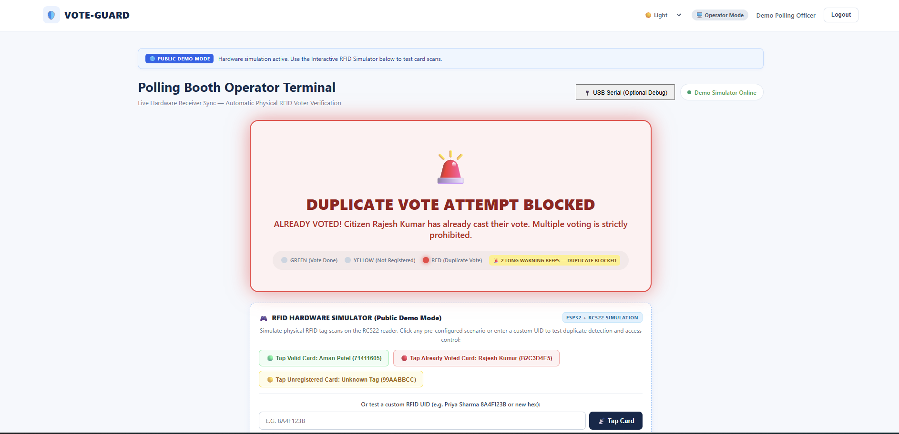
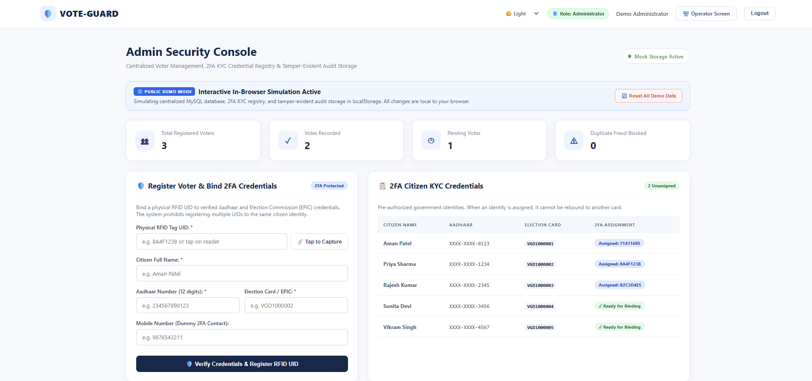
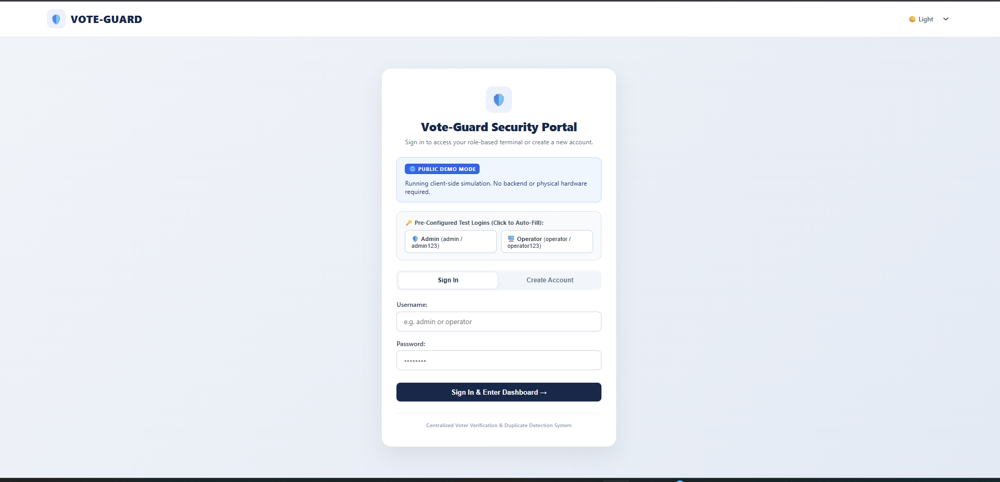
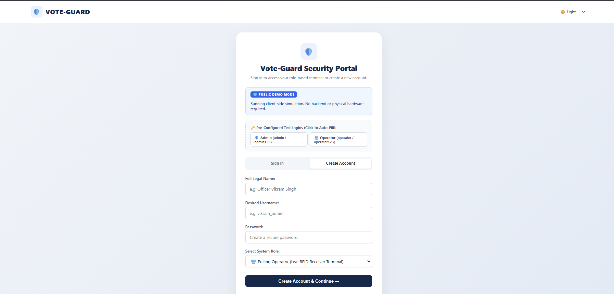
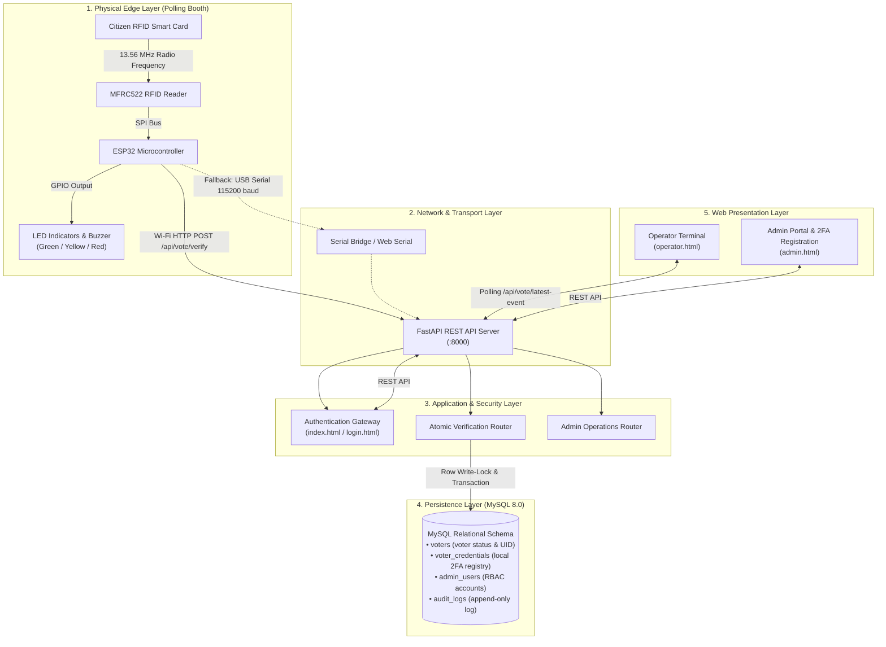
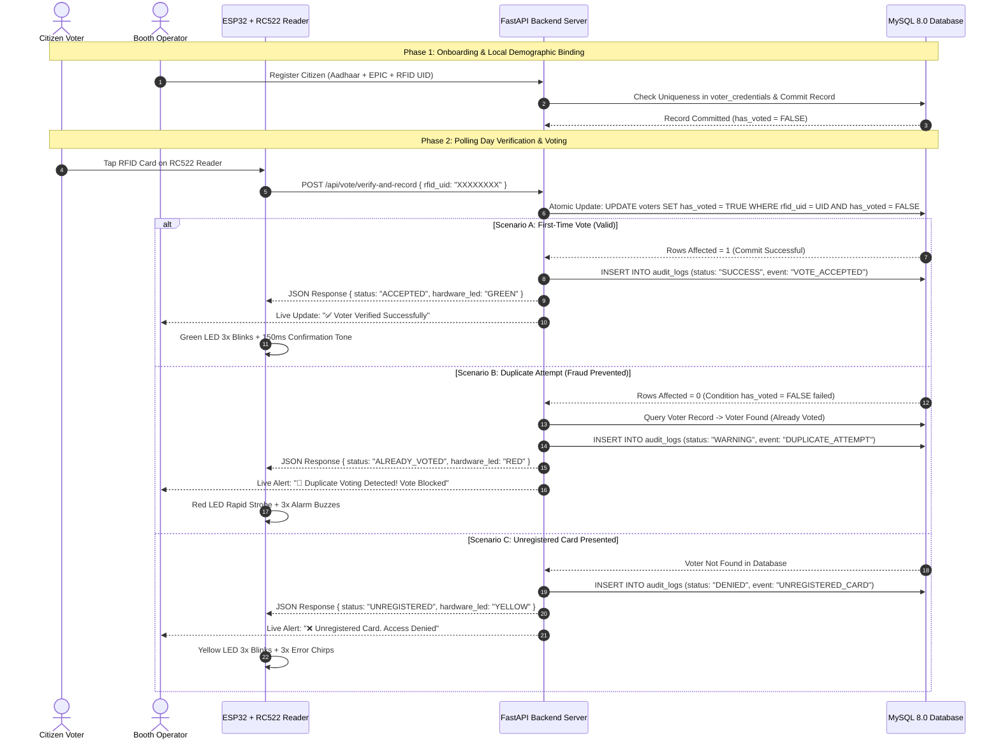

# Vote-Guard: RFID-Based Voter Verification & Duplicate-Vote Prevention Platform

[](https://atikansari.github.io/Vote-Guard/)
[](https://fastapi.tiangolo.com)
[](https://www.python.org/)
[](https://www.mysql.com/)
[](https://www.espressif.com/)
[](https://silveroakuni.ac.in)

> **Academic Engineering Prototype:** Vote-Guard is an edge-to-cloud electoral verification platform that combines physical RFID smart tokens, a local two-factor demographic credential binding layer (simulating pre-authorized Aadhaar & EPIC voter rolls), and an atomic backend database engine to enforce an **exactly-once voting constraint** across distributed polling kiosks in local testing environments.
>
> *Disclaimer: This project is an educational engineering prototype developed for academic review. It implements local relational database validations and does not interface with live government identity APIs (such as UIDAI Aadhaar or ECI). It is not certified for statutory or governmental elections.*

---

## Table of Contents

1. [Project Overview](#1-project-overview)
2. [Live Demo & Operating Modes](#2-live-demo--operating-modes)
   - [Live Demo](#live-demo)
   - [Demo Mode vs Full-Stack Mode](#demo-mode-vs-full-stack-mode)
   - [Public Demo Credentials](#public-demo-credentials)
   - [Application Screenshots](#application-screenshots)
3. [Problem Statement](#3-problem-statement)
4. [Project Objectives](#4-project-objectives)
5. [Key Features](#5-key-features)
6. [Technology Stack](#6-technology-stack)
7. [System Architecture](#7-system-architecture)
8. [Project Workflow](#8-project-workflow)
9. [Project Folder Structure](#9-project-folder-structure)
10. [Installation and Setup](#10-installation-and-setup)
11. [Backend Configuration](#11-backend-configuration)
12. [Database Configuration](#12-database-configuration)
13. [ESP32 and RC522 Hardware Setup (Optional)](#13-esp32-and-rc522-hardware-setup-optional)
14. [API Overview](#14-api-overview)
15. [Demo Instructions](#15-demo-instructions)
16. [Security & Architectural Scope](#16-security--architectural-scope)
17. [Current Project Status](#17-current-project-status)
18. [Future Enhancements](#18-future-enhancements)
19. [Contributors & Project Credits](#19-contributors--project-credits)

---

## 1. Project Overview

**Vote-Guard** is a full-stack electoral security and verification prototype engineered as a Problem Based Learning (PBL-I) project. It addresses two core vulnerabilities in conventional electoral operations: **voter impersonation** and **duplicate voting (double voting)** across polling stations.

The platform introduces a multi-tier verification workflow:
- **Physical RFID Smart Tokens:** 13.56 MHz High-Frequency RFID cards/fobs mapped uniquely to individual voter records.
- **Local Two-Factor Demographic Binding (Simulated 2FA KYC):** Maps each physical token to pre-authorized citizen credential records (Aadhaar number and Election Photo Identity Card / EPIC) in a local relational database, simulating a validated government voter roll without requiring external API access.
- **Atomic Verification Engine:** An asynchronous **FastAPI backend** running conditional SQL updates on **MySQL 8.0 (InnoDB)** with row-level write-locks to prevent concurrent duplicate votes.
- **Dual-Channel Hardware & Web Sync:** Real-time visual and acoustic feedback at the polling kiosk via **ESP32 microcontroller actuators** (Green/Yellow/Red LEDs and an active buzzer) synchronized with browser-based operator and administrative dashboards.

---

## 2. Live Demo & Operating Modes

### Live Demo

[](https://atikansari.github.io/Vote-Guard/)

**Live Demo URL:** [https://atikansari.github.io/Vote-Guard/](https://atikansari.github.io/Vote-Guard/)

> [!NOTE]
> This is a **publicly accessible simulated demonstration** hosted directly on GitHub Pages. It allows recruiters, developers, and evaluators to interact with the voting verification workflows, test simulated RFID card scans, and verify duplicate-vote prevention in real time without installing Python, configuring MySQL, or connecting physical microcontrollers.

---

### Demo Mode vs Full-Stack Mode

Vote-Guard maintains **one unified repository** engineered with **two distinct operating modes**:

| Feature / Aspect | 🌐 Public Demo Mode (GitHub Pages) | ⚡ Full-Stack Mode (Local / Field) |
| :--- | :--- | :--- |
| **Hosting & URL** | Hosted statically on GitHub Pages: `https://atikansari.github.io/Vote-Guard/` | Runs locally via Uvicorn: `http://127.0.0.1:8000` |
| **Frontend Stack** | HTML5, CSS3, Vanilla ES6+ JavaScript | HTML5, CSS3, Vanilla ES6+ JavaScript |
| **Backend Engine** | `demo-mock-engine.js` (In-browser mock engine) | Python FastAPI asynchronous REST backend |
| **Data Persistence** | Browser `localStorage` (Isolated namespace `voteGuard_demo_*`) | MySQL 8.0+ (InnoDB ACID row-level write-locks) |
| **Database ORM** | In-memory JavaScript collections | SQLAlchemy 2.0 ORM |
| **RFID Verification** | Interactive on-screen RFID hardware simulator dock | Physical ESP32 DevKit V1 + RC522 RFID reader |
| **Actuator Feedback** | Screen LED lamps + Web Audio API synthesizer | Physical Green, Yellow, Red LEDs + Active Piezo Buzzer |
| **Hardware Required** | **None** (Zero hardware, zero local installation) | ESP32 DevKit V1, RC522 reader, LEDs, Buzzer |
| **Backend Dependencies**| **None** (No FastAPI, No Python, No MySQL) | Python 3.10+, FastAPI, MySQL Server, PyMySQL |
| **Data Isolation** | Browser-specific, non-persistent across devices | Centralized, persistent across all polling stations |
| **Data Reset** | One-click button resets `localStorage` to seed state | Dedicated administrative reset endpoint |

#### Public Demo Mode
- **Hosted using GitHub Pages:** Served statically directly from the root repository on the `main` branch.
- **Pure Client-Side Stack:** Uses semantic HTML, responsive CSS, and Vanilla JavaScript with `demo-mock-engine.js`.
- **Browser LocalStorage:** Simulates the centralized database in `localStorage` under dedicated namespaces (`voteGuard_demo_voters`, `voteGuard_demo_credentials`, `voteGuard_demo_users`, `voteGuard_demo_audit`, `voteGuard_demo_latestEvent`). Local browser storage is used strictly for client-side demonstration state and is not tamper-proof or cryptographically secure.
- **Fictional Voter Records:** Uses synthetic sample identities (Aman Patel, Priya Sharma, Rajesh Kumar, Sunita Devi, Vikram Singh).
- **Simulated RFID Verification:** Features an on-screen simulator dock on the Operator Terminal for valid, duplicate, and unregistered card scans.
- **Duplicate Voting Prevention Demonstrations:** Simulates duplicate-vote prevention using browser-side logic to replicate single-vote verification.
- **No External Backend or Hardware Required:** Does not require FastAPI, MySQL, ESP32 microcontrollers, or physical RC522 readers.
- **Zero Real Network Calls:** Operates entirely in client memory; does not connect to the actual backend or external databases.
- **Browser-Specific & Resettable:** Changes exist only in the visitor's local browser and can be reset to pristine seed data with one click.

#### Full-Stack Mode
- **Runs Locally:** Accessed through `http://127.0.0.1:8000`.
- **Frontend:** Standard responsive web interface (`index.html`, `login.html`, `operator.html`, `admin.html`).
- **Backend:** High-performance asynchronous Python FastAPI framework with Pydantic type validation.
- **Database:** MySQL 8.0 database with InnoDB storage engine enforcing relational constraints.
- **ORM:** SQLAlchemy 2.0 managing transactions, relationships, and queries.
- **Hardware Integration:** Real-time communication with ESP32 DevKit V1 and MFRC522 13.56 MHz RFID readers over Wi-Fi (HTTP POST) or USB COM port (115200 baud).
- **Actual Backend Authentication:** PBKDF2-HMAC-SHA256 password hashing with 100,000 iterations and RFC 7519 HMAC-SHA256 JWT session tokens.
- **Physical Actuation:** Drives physical Green, Yellow, and Red LEDs and an active buzzer on the polling kiosk.

> [!IMPORTANT]
> **Hosting Clarification:** GitHub Pages hosts **only the public demonstration**, not the FastAPI backend or MySQL database. To experience Full-Stack Mode with live database transactions or physical hardware, run the project locally following the [Installation and Setup](#10-installation-and-setup) guide.

---

### Public Demo Credentials

Visitors can explore both role-based dashboards in the live demo using the pre-configured credentials:

| Role | Username | Password | Dashboard Access | Access URL |
| :--- | :--- | :--- | :--- | :--- |
| **Polling Operator** | `operator` | `operator123` | Live RFID terminal, scan simulator, and audio alerts | [`operator.html`](https://atikansari.github.io/Vote-Guard/operator.html) |
| **System Administrator** | `admin` | `admin123` | Voter management, 2FA KYC binding, stats, and audit trail | [`admin.html`](https://atikansari.github.io/Vote-Guard/admin.html) |

> [!WARNING]
> **Public Demonstration Notice:**
> - These are **public demonstration credentials** intended strictly for exploring the interactive demo.
> - **Never use these default credentials** for real authentication or production deployments.
> - Anyone visiting the public demo can log in with these credentials.
> - The public demo uses simulated client-side session routing and is **not presented as a production-secure voting system**. Real cryptographic authentication (PBKDF2-HMAC-SHA256 password hashing with 100,000 iterations and RFC 7519 HMAC-SHA256 JWT tokens) is implemented exclusively in Full-Stack Mode through the FastAPI backend.

---

### Application Screenshots

#### Operator Dashboard
The Polling Booth Operator Terminal features live RFID card verification, single-focus visual status indicators, synchronized LED lamps, audio buzzer feedback, and the interactive RFID test scanner dock:



#### Admin Dashboard
The Administrative Console provides real-time turnout metrics, 2FA government KYC credential binding, official registered voter directory, recorded vote list, and simulated audit activity:



#### Login Portal
The entry portal provides role-based authentication with quick-fill demo buttons and theme switching:



#### Account Registration
Administrative form binding physical RFID tag UIDs to pre-authorized Aadhaar and EPIC credentials with duplicate-identity prevention:



---

## 3. Problem Statement

Conventional manual and standalone electronic electoral systems face operational challenges:
1. **Voter Impersonation & Forgery:** Traditional paper voter slips or unverified physical photo cards can be forged or presented by unauthorized proxies.
2. **Cross-Booth Double Voting:** Without synchronized, real-time cross-booth verification, an individual can attempt to cast ballots at multiple physical polling stations.
3. **Time-of-Check to Time-of-Use (TOCTOU) Exploits:** Systems that read a voter's status before writing without atomic database locks are susceptible to race conditions if two kiosks process the same credential at the same millisecond.
4. **Lack of Immediate Edge Feedback:** Polling officers often lack instantaneous audio-visual hardware cues to detect duplicate or unregistered cards directly at the card reader terminal.

---

## 4. Project Objectives

- **Enforce Exactly-Once Invariant:** Mathematically guarantee that every registered voter record transitions from `has_voted = FALSE` to `TRUE` exactly once ($V = 1$), rejecting subsequent attempts ($V > 1$) in both automated test suites and real-time operational testing.
- **Relational Demographic Binding:** Prevent multi-card issuance by enforcing strict database uniqueness constraints across RFID UIDs, simulated Aadhaar numbers, and EPIC codes.
- **Atomic Concurrency Protection:** Eliminate race conditions between kiosks by performing atomic conditional updates (`UPDATE ... WHERE has_voted = FALSE`) backed by MySQL InnoDB exclusive row write-locks.
- **Edge Actuator Feedback:** Provide instant hardware diagnostic signals (Green/Yellow/Red LEDs + Buzzer) at the physical reader and push live scan events to the operator terminal.
- **Application-Level Audit Trail:** Record an append-only log entry for every interaction (vote cast, duplicate attempt, unregistered card presentation) capturing timestamps, client socket IP addresses, and forensic event details.

---

## 5. Key Features

- **Atomic Verification Engine:** Evaluates RFID tags using a single conditional write query in MySQL. If `has_voted` is `FALSE`, the vote is committed in one atomic step; if already `TRUE`, zero rows are modified, safely triggering a duplicate alarm.
- **Simulated 2FA KYC Voter Registration:** Administrative onboarding portal that enforces relational uniqueness constraints across RFID UIDs, Aadhaar numbers, and EPIC codes, simulating a pre-authorized government voter registry.
- **Dual Communication Modes (Edge Hardware):**
  - **Wi-Fi Mode (Primary):** Microcontroller directly transmits JSON payloads over HTTP POST to the FastAPI backend via local wireless LAN.
  - **USB Serial Bridge Mode (Diagnostic / Fallback):** Microcontroller streams card UIDs over USB COM port (115200 baud) for environments utilizing the local Python bridge script or browser Web Serial API.
- **Role-Based Access Control (RBAC):** Protected sessions for **System Administrators** (analytics, voter registry, audit trail, credential management) and **Booth Operators** (live polling terminal).
- **Live Booth Operator Terminal:** Real-time web terminal featuring Web Audio API sound synthesis, card verification status banners, and automatic reset timers between voters.
- **Audit Logging & Turnout Analytics:** Tracks turnout metrics, pending votes, and blocked fraud attempts with interactive visualization powered by Chart.js.

---

## 6. Technology Stack

### Frontend
- **Markup & Structure:** HTML5 (Semantic Structure)
- **Styling:** CSS3 (Custom Responsive Design System, CSS Variables, Status Badges)
- **Client Logic:** Vanilla JavaScript (ES6+, Fetch API, Web Audio API, Web Serial API)
- **Data Visualization:** Chart.js (CDN-hosted analytics charts)

### Backend
- **Framework:** FastAPI (High-performance asynchronous Python web framework)
- **ASGI Web Server:** Uvicorn (Asynchronous server implementation)
- **ORM & Data Mapping:** SQLAlchemy 2.0 (Relational mapping and session management)
- **Validation:** Pydantic (Type enforcement and schema validation)
- **Security & Authentication:** Python Cryptography & Secrets (`hashlib.pbkdf2_hmac` SHA-256 with 100,000 iterations, RFC 7519 HMAC-SHA256 JWT sessions)
- **Environment Management:** Python-Dotenv

### Database
- **Engine:** MySQL 8.0+ (InnoDB storage engine supporting ACID transactions and row-level write-locks)
- **Driver:** PyMySQL (Pure-Python MySQL client)
- **Charset:** `utf8mb4` with `utf8mb4_unicode_ci` collation

### Hardware Integration (Local Prototype Testing)
- **Microcontroller:** ESP32 DevKit V1 (30-pin, Dual-Core 240 MHz, 2.4 GHz 802.11 b/g/n Wi-Fi)
- **RFID Module:** MFRC522 13.56 MHz High-Frequency RFID Transceiver (SPI Interface)
- **Feedback Actuators (Active HIGH):**
  - Green LED (GPIO 25): Verified Voter / Vote Accepted (3 distinct blinks + 150ms tone)
  - Yellow LED (GPIO 26): Unregistered Card Presented (3 blinks + 3 alert chirps)
  - Red LED (GPIO 27): Duplicate Vote Blocked (3 alarm buzzes + rapid red strobe)
  - Active Piezo Buzzer (GPIO 32): Distinct audible alert frequencies

---

## 7. System Architecture

The Vote-Guard system follows a modular edge-to-cloud tiered architecture:



---

## 8. Project Workflow



---

## 9. Project Folder Structure

```text
VOTE-GUARD/
├── index.html                   # Sign In & Authentication Portal (Default landing page)
├── login.html                   # Dedicated Role-Based Login & Signup Gateway (Admin / Operator)
├── operator.html                # Polling Booth Operator Live Terminal (Live sync & event polling)
├── admin.html                   # Central Security Dashboard & 2FA Voter Registration (#voterRegistrationForm)
├── style.css                    # Unified responsive stylesheet
├── script.js                    # Registration client logic & Web Serial handler
├── auth.js                      # Client-side session tokens & route guards
├── operator.js                  # Polling synchronization & audio alerts
├── admin.js                     # Admin dashboard metrics & voter table CRUD
├── demo-mock-engine.js          # Public Demo Mode client-side mock engine & Web Audio synthesizer
├── run_backend.py               # Root FastAPI launcher script
├── start_vote_guard.bat         # Windows one-click batch launcher
├── serial_bridge.py             # USB Serial-to-HTTP gateway bridge
├── .gitignore                   # Git exclusion rules for secrets, venv & cache
│
├── screenshots/                 # Application screenshots for repository documentation
│   ├── operator.png             # Polling Booth Operator Terminal interface
│   ├── admin.png                # Admin Security & 2FA Console interface
│   ├── login.png                # Authentication & gateway interface
│   └── signup.png               # Account registration interface
│
├── backend/                     # Python FastAPI Backend
│   ├── .env.example             # Environment configuration template (Copy to .env)
│   ├── requirements.txt         # Pip dependency manifest
│   ├── main.py                  # Direct backend launcher entry point
│   ├── init_db.py               # Database table initializer & seed utility
│   ├── inspect_db.py            # CLI database inspection script
│   ├── clean_dummy_data.py      # Test record cleanup script
│   ├── test_logic.py            # Unit tests for exactly-once voting logic
│   ├── test_lan_vote.py         # LAN network endpoint tests
│   └── app/                     # Core application package
│       ├── __init__.py
│       ├── main.py              # FastAPI app instance, CORS & static mounts
│       ├── database.py          # SQLAlchemy connection engine & session maker
│       ├── models.py            # ORM entities (AdminUser, VoterCredential, Voter, AuditLog)
│       ├── schemas.py           # Pydantic request/response validation schemas
│       ├── auth.py              # Password hashing & JWT validation functions
│       └── routers/             # Modular API controllers
│           ├── __init__.py
│           ├── auth.py          # User authentication endpoints
│           ├── voting.py        # Core voting verification & event polling
│           └── admin.py         # Administrative CRUD & audit logs
│
├── firmware/                    # Embedded Hardware Integration
│   └── vote_guard_esp32/
│       ├── vote_guard_esp32.ino # Arduino C++ firmware for ESP32 + RC522
│       └── config.example.h     # Safe hardware config template (Copy to config.h)
│
├── VOTE-GUARD-Documentation/    # Complete system design specifications & BOM guides
├── Final_Project_Report/        # Final university academic report & verification suite
└── paper/                       # IEEE-formatted academic research paper
```

---

## 10. Installation and Setup

### Prerequisites
- **Python:** Version 3.10 or higher (Python 3.14 compatible).
- **Database Server:** MySQL 8.0 or higher running locally or on your local network.
- **Git:** Installed on your development environment.
- **Arduino IDE (Optional):** Required only if compiling and flashing physical ESP32 hardware.

### Step 1: Clone the Repository
```bash
git clone https://github.com/AtikAnsari/Vote-Guard.git
cd Vote-Guard
```

### Step 2: Set Up Python Virtual Environment
```bash
# Create a virtual environment
python -m venv .venv

# Activate the virtual environment
# On Windows (PowerShell):
.venv\Scripts\Activate.ps1
# On Windows (Command Prompt):
.venv\Scripts\activate.bat
# On macOS / Linux:
source .venv/bin/activate
```

### Step 3: Install Backend Dependencies
```bash
pip install --upgrade pip
pip install -r backend/requirements.txt
```

---

## 11. Backend Configuration

The backend dynamically reads environment variables for its configuration. A safe template `backend/.env.example` is provided in the repository.

1. Navigate to the `backend/` folder and create your local `.env` file:
   ```bash
   # On Windows:
   copy backend\.env.example backend\.env
   # On Linux/macOS:
   cp backend/.env.example backend/.env
   ```

2. Open `backend/.env` in your text editor and update your database credentials:
   ```ini
   # Application Settings
   APP_NAME="VOTE-GUARD Verification API"
   APP_VERSION="1.0.0"
   APP_ENV="development"
   HOST="0.0.0.0"
   PORT=8000
   DEBUG=True

   # MySQL Database Settings (Set to your local MySQL server)
   DB_HOST="127.0.0.1"
   DB_PORT=3306
   DB_USER="root"
   DB_PASSWORD="your_local_mysql_password_here"
   DB_NAME="vote_guard"
   DB_ECHO=False

   # Security Secrets (Session & JWT Token Signing)
   SECRET_KEY="generate-a-secure-random-secret-key-here"
   JWT_SECRET_KEY="your_secure_random_secret_key_here"
   ```

> [!CAUTION]
> The `.env` file contains sensitive local credentials. It is permanently excluded from Git by `.gitignore`. Never commit or publish your `.env` file.

> [!IMPORTANT]
> **JWT Secret Key Security:** Ensure `JWT_SECRET_KEY` is explicitly set in your `.env` file with a strong random string (e.g. generated via `openssl rand -hex 32`). If omitted, the application falls back to an internal default key suitable only for offline local testing; in production, always configure a dedicated secret to prevent token forgery.

---

## 12. Database Configuration

### Step 1: Create the MySQL Database
Log into your MySQL command-line client or MySQL Workbench:
```sql
CREATE DATABASE vote_guard CHARACTER SET utf8mb4 COLLATE utf8mb4_unicode_ci;
```

### Step 2: Initialize Tables & Seed Accounts
Run the automated initialization script from the project root:
```bash
python backend/init_db.py
```

What `init_db.py` does:
1. Connects to your configured MySQL server.
2. Creates the four relational tables (`admin_users`, `voter_credentials`, `voters`, `audit_logs`) safely with `IF NOT EXISTS`.
3. Seeds initial local development accounts for offline testing:
   - Default Administrator role (`admin`)
   - Default Polling Operator role (`operator`)

> [!IMPORTANT]
> Initial seed accounts are created for local development and demonstration only. For production or networked environments, update these credentials immediately or register new accounts via `login.html`.

### Step 3: Start the Backend Server
Launch the FastAPI server from the project root:
```bash
python run_backend.py
```
*(On Windows, you can also double-click `start_vote_guard.bat`)*

The server will initialize on `http://0.0.0.0:8000` (accessible via `http://localhost:8000` and over your local LAN).

---

## 13. ESP32 and RC522 Hardware Setup (Optional)

> **Note:** Physical hardware is **strictly optional** for reviewing, testing, or exploring Vote-Guard. The entire platform includes a software simulation workflow allowing complete demonstration through the web interface.

If you have physical hardware and want to deploy the embedded edge scanner:

### Component Pinout Mapping

| Component Pin | ESP32 DevKit V1 Pin | Electrical Notes / Safety |
| :--- | :--- | :--- |
| **RC522 3.3V** | **3V3** | **STRICTLY 3.3V.** Never connect to 5V or VIN (damages the RFID chip). |
| **RC522 GND** | **GND** | Common ground with ESP32. |
| **RC522 RST** | **GPIO 4** | Reset control line. |
| **RC522 MISO**| **GPIO 19**| Hardware SPI Master-In Slave-Out. |
| **RC522 MOSI**| **GPIO 23**| Hardware SPI Master-Out Slave-In. |
| **RC522 SCK** | **GPIO 18**| Hardware SPI Clock. |
| **RC522 SDA (SS)** | **GPIO 5** | Hardware SPI Slave Select / Chip Select. |
| **Green LED Anode**| **GPIO 25** | Through 220Ω current-limiting resistor to GND. |
| **Yellow LED Anode**| **GPIO 26**| Through 220Ω current-limiting resistor to GND. |
| **Red LED Anode** | **GPIO 27** | Through 220Ω current-limiting resistor to GND. |
| **Active Buzzer (+)** | **GPIO 32** | Signal pin (Cathode / Negative to GND). |

### Firmware Configuration & Flashing

1. Navigate to `firmware/vote_guard_esp32/`.
2. Copy `config.example.h` to `config.h`:
   ```bash
   cp firmware/vote_guard_esp32/config.example.h firmware/vote_guard_esp32/config.h
   ```
3. Open `config.h` and configure your local Wi-Fi credentials and laptop LAN IP:
   ```c
   #define WIFI_SSID       "YOUR_LOCAL_WIFI_SSID"
   #define WIFI_PASSWORD   "YOUR_LOCAL_WIFI_PASSWORD"
   #define BACKEND_BASE_URL "http://192.168.1.100:8000" // Your laptop's IPv4 address from 'ipconfig'
   ```
4. Open `vote_guard_esp32.ino` in the Arduino IDE.
5. In **Tools > Board**, select **ESP32 Dev Module**.
6. In **Tools > Manage Libraries**, install `MFRC522` by GithubCommunity.
7. Connect your ESP32 via USB and click **Upload**.

---

## 14. API Overview

The FastAPI backend provides structured, self-documenting RESTful endpoints accessible at `http://localhost:8000/docs` (Swagger UI) and `http://localhost:8000/redoc`.

| Method | Endpoint | Access | Description |
| :---: | :--- | :---: | :--- |
| `GET` | `/health` | Public | System health check and live MySQL database connectivity diagnostic. |
| `POST`| `/api/auth/login` | Public | Authenticates users (admin/operator) and returns a signed JWT token with role-based redirect URL. |
| `POST`| `/api/auth/signup` | Public | Registers a new administrative or booth operator user. |
| `GET` | `/api/auth/me` | Authenticated | Returns profile information for the active user session. |
| `POST`| `/api/vote/verify-and-record` | Edge / Operator | Core verification endpoint. Executes atomic conditional write and returns hardware LED feedback directives. |
| `GET` | `/api/vote/latest-event` | Operator | Polling endpoint returning the latest hardware RFID scan event. |
| `GET` | `/api/vote/history` | Operator | Returns the 10 most recent vote verification events for live terminal feed. |
| `GET` | `/api/vote/recorded-rfids` | Operator / Admin | Returns list of RFID UIDs that have already cast votes (used for frontend state synchronization). |
| `GET` | `/api/vote/public-stats` | Public | Returns voter turnout counts and fraud attempt totals. |
| `GET` | `/api/admin/stats` | Admin | Comprehensive analytics (total voters, votes cast, pending, duplicate attempts, available credentials). |
| `GET` | `/api/admin/voters` | Admin | Retrieves all registered voters with individual voting status. |
| `POST`| `/api/admin/voters` | Admin | Registers a voter with local 2FA Aadhaar + EPIC + RFID binding. |
| `GET` | `/api/admin/credentials` | Admin | Lists local pre-authorized citizen credential records. |
| `POST`| `/api/admin/credentials` | Admin | Pre-loads citizen credential records into the local mock registry. |
| `GET` | `/api/admin/audit-logs` | Admin | Retrieves persistent application-level audit log entries. |
| `POST`| `/api/admin/reset-votes` | Admin | Resets voting status to `FALSE` across voters for repeated test/demo cycles without deleting records. |

---

## 15. Demo Instructions

You can demonstrate the complete Vote-Guard verification lifecycle either **online via GitHub Pages** (zero installation) or **locally in Full-Stack Mode**.

> [!NOTE]
> **Simulated Credentials & Hardware-Free Evaluation:** All demo workflows utilize simulated or local data. The platform does not connect to real government databases, and physical hardware is not required to test the complete verification and duplicate-detection pipeline.

### Option A: Online Interactive Demo (GitHub Pages — Instant)

1. Open the [Live Demo](https://atikansari.github.io/Vote-Guard/) in any web browser.
2. Click the quick-fill button **🖥️ Operator (operator / operator123)** and click **Sign In**.
3. On the **Polling Booth Operator Terminal**:
   - Click **🟢 Tap Valid Voter Card (Aman Patel - 71411605)**: The result card turns Green (`✅ VOTE IS DONE & RECORDED`), the Green LED illuminates, and a confirmation tone plays.
   - Click the same button again: The result card turns Red (`🚨 DUPLICATE VOTE ATTEMPT BLOCKED`), the Red LED illuminates, two alert buzzes sound, and the fraud attempt is blocked.
   - Click **🟡 Tap Unregistered Card (99AABBCC)**: The result card turns Yellow (`⚠️ VOTER ID IS NOT REGISTERED`) and warning chirps sound.
4. Click **Logout**, then click **🛡️ Admin (admin / admin123)** and click **Sign In**.
5. On the **Admin Security Dashboard**:
   - Check the **Turnout Stats**: Notice the recorded votes and blocked fraud attempts are automatically synchronized.
   - Scroll to **Register Voter & Bind 2FA Credentials**: Enter a new RFID UID (e.g. `E4D3C2B1`) with citizen details for Sunita Devi (`Aadhaar: 567890123456`, `EPIC: VGD1000004`) and click **Verify Credentials & Register RFID UID**.
   - Inspect the **Simulated Audit Activity**: Every scan, duplicate attempt, and registration is chronologically recorded with simulated timestamps in browser storage.
   - Click **⚠️ Reset Voting Statuses (Demo Mode)**: Resets all votes back to pending for another test cycle while preserving registered voters and KYC credentials.

---

### Option B: Local Full-Stack Demo (FastAPI + MySQL)

With the server running on `http://localhost:8000`:
- **Portal Entry / Gateway:** `http://localhost:8000/` or `http://localhost:8000/login.html` (or `index.html`)
- **Booth Operator Terminal:** `http://localhost:8000/operator.html`
- **Admin Security Dashboard & 2FA Voter Registration:** `http://localhost:8000/admin.html`
- **Interactive API Docs:** `http://localhost:8000/docs`

#### Step-by-Step Full-Stack Software Simulation Demo

1. **Log In:**
   - Open `http://localhost:8000/login.html` (or `index.html`).
   - Log in using your registered credentials or select your designated role (`admin` or `operator`) to enter the appropriate portal.

2. **Register a Test Voter (Local 2FA Credential Binding):**
   - Navigate to `http://localhost:8000/admin.html` (Admin Security Portal).
   - Locate the **Register New Voter (2FA Binding)** form (`#voterRegistrationForm`) and enter citizen details:
     - Citizen Full Name: `Jane Doe`
     - Aadhaar Number (12 digits): `1234 5678 9012`
     - Election Card / EPIC: `ABC1234567`
     - Physical RFID Tag UID: `A1B2C3D4` *(Enter any 8-character hex string for simulation or click "Tap to Capture")*
   - Click **Verify Credentials & Register RFID UID**. The credential uniqueness is validated against the local database schema and stored with `has_voted = False`.

3. **Simulate First-Time Vote (Valid Vote Accepted):**
   - Open `http://localhost:8000/operator.html` in another tab or window.
   - Use the **Interactive Test Scan** / Web input to trigger verification for UID `A1B2C3D4` *(or use the `/api/vote/verify-and-record` endpoint in Swagger docs)*.
   - **Observed Result:**
     - Status: `ACCEPTED` (Green badge).
     - Message: `✅ Voter Verified Successfully. Vote recorded.`
     - Audio: Single positive confirmation tone.
     - Database: `has_voted` transitions from `FALSE` to `TRUE`, timestamp is recorded.

4. **Simulate Second Vote Attempt (Duplicate Blocked):**
   - Submit the same UID `A1B2C3D4` a second time on the operator terminal.
   - **Observed Result:**
     - Status: `ALREADY_VOTED` (Red alert modal).
     - Message: `🚨 Duplicate Voting Detected! Vote blocked.`
     - Audio: Distinct rapid alert tone.
     - Database: Vote count remains unchanged; an audit log entry with `DUPLICATE_ATTEMPT` is recorded.

5. **Simulate Unregistered Card:**
   - Submit an unassigned UID such as `FFFFFFFF`.
   - **Observed Result:**
     - Status: `UNREGISTERED` (Yellow warning).
     - Message: `❌ Voter is not registered. Access denied.`

6. **Inspect the Audit Trail:**
   - Open `http://localhost:8000/admin.html`.
   - View live voter turnout statistics and inspect the **Audit Trail** table showing timestamps, client socket IPs, and event details.

---

## 16. Security & Architectural Scope

- **Credential Isolation:** Real database passwords, secret keys, and local Wi-Fi credentials are strictly isolated into `.env` and `config.h`, which are prevented from being pushed to version control via `.gitignore`.
- **Atomic Database Write-Locks:** Concurrency protection is achieved at the database engine level. Using a conditional update (`UPDATE voters SET has_voted = TRUE WHERE rfid_uid = :uid AND has_voted = FALSE`), MySQL InnoDB row-level write-locks ensure that only the first incoming request can modify the row, blocking concurrent multi-booth race conditions (TOCTOU).
- **Password Protection:** User passwords are encrypted using one-way PBKDF2-HMAC-SHA256 with 100,000 iterations and cryptographic salting (constant-time verification via `secrets.compare_digest`) before storage in the database.
- **Serial Gateway Protocol:** When operating over USB Serial, the ESP32 firmware transmits ASCII lines containing the scanned card UID string (`[RFID-SCAN] Scanned Card UID: <HEX_UID>`). The Python host bridge (`serial_bridge.py`) extracts this UID, queries `POST /api/vote/verify-and-record`, and writes back single-byte ASCII directives (`'V'` for valid/accepted, `'D'` for duplicate, `'U'` for unregistered) to actuate physical LED and buzzer feedback.
- **Append-Only Application Audit Trail:** Verification events are recorded in an insert-only audit log table at the application layer. While not a cryptographic or blockchain-enforced write-once ledger, the application exposes no modification or deletion endpoints for audit records.
- **Client Socket IP Capture:** The backend records `request.client.host` for forensic tracking, capturing the connecting network socket IP (such as the local LAN IP of the ESP32 or the operator's browser).
- **Simulated National ID Scope:** Aadhaar and EPIC numbers are validated against local database schema constraints as a proof-of-concept. The system does not connect to statutory government verification APIs.
- **Academic Prototype Scope:** Vote-Guard is an educational engineering prototype developed for academic evaluation. It is not certified for statutory or governmental public elections.

---

## 17. Current Project Status

| Feature / Subsystem | Implementation Status | Technical Verification Notes |
| :--- | :---: | :--- |
| **Public Demo Mode (GitHub Pages)** | **Fully Implemented** | Client-side mock engine (`demo-mock-engine.js`), hardware simulator dock & sound cues active. |
| **FastAPI REST Backend** | **Fully Implemented** | Modular routing, CORS, and health checks verified in `backend/app/main.py`. |
| **MySQL Relational Schema** | **Fully Implemented** | Normalized models for voters, credentials, users, and logs verified in `backend/app/models.py`. |
| **Exactly-Once Voting Invariant** | **Fully Implemented** | Atomic conditional update verified via `backend/test_logic.py`. |
| **2FA Demographic Binding** | **Implemented (Local Simulation)** | Relational uniqueness constraints enforced in MySQL; does not call external government APIs. |
| **Role-Based Auth (Admin/Operator)** | **Fully Implemented** | PBKDF2-HMAC-SHA256 password hashing and JWT token routing verified in `backend/app/routers/auth.py`. |
| **Live Operator Terminal** | **Fully Implemented** | Real-time polling sync, Web Audio cues, and alert modals active in `operator.js`. |
| **Admin Security Dashboard** | **Fully Implemented** | Statistics, Chart.js turnout charts, and audit trail pagination active in `admin.js`. |
| **ESP32 C++ Firmware** | **Fully Implemented** | Wi-Fi HTTP client, SPI RC522 driver, LED & buzzer routines verified in `vote_guard_esp32.ino`. |
| **Hardware Serial Bridge** | **Fully Implemented** | Standalone Python serial gateway (`serial_bridge.py`) and Web Serial API support ready. |
| **Automated Test Suites** | **Fully Implemented** | `test_logic.py`, `test_lan_vote.py`, `test_server_http.py` passing. |

---

## 18. Future Enhancements

The following features represent conceptual architectural enhancements planned for future research iterations:

- [ ] **Biometric Fingerprint Multi-Factor Authentication:** Adding an optical or capacitive fingerprint scanner (e.g., R307/FPM10A) to the ESP32 node for 3-factor physical verification.
- [ ] **Cryptographic Zero-Knowledge Ballot Receipts:** Implementing verifiable zero-knowledge proofs (zk-SNARKs) allowing citizens to verify their ballot was counted without compromising vote secrecy.
- [ ] **Decentralized Audit Ledger:** Integrating a lightweight distributed ledger (Hyperledger Fabric or private Ethereum) for consensus-driven cross-booth audit logging.
- [ ] **Full WebSocket Push Infrastructure:** Upgrading operator polling to bidirectional WebSockets for sub-millisecond edge event streaming.
- [ ] **Encrypted Offline Edge Storage:** Implementing AES-256 encrypted forward-secure flash buffers on the ESP32 to support temporary operation during network dropouts.

---

## 19. Contributors & Project Credits

This project was engineered and developed as a Problem Based Learning (PBL-I) project under the Department of Computer Science and Engineering, College of Technology, Silver Oak University:

### Student Engineering Team
- **Ansari Mo.Atik** — *Full-Stack Architecture, FastAPI Backend & ESP32 Firmware Development*
- **Shaikh Sakib Ahmed** — *Hardware Integration, RFID Circuitry & Embedded Actuation*
- **Shaikh Sejan** — *Database Architecture, 2FA KYC Schema & Audit Logging*

### Faculty Mentor & Project Advisory
- **Prof. Urmil Mewada** — *Project Guide, Department of Computer Engineering, College of Technology, Silver Oak University*

---

*For technical inquiries or academic review, refer to the detailed documentation located in `VOTE-GUARD-Documentation/` and the research paper in `paper/`.*
