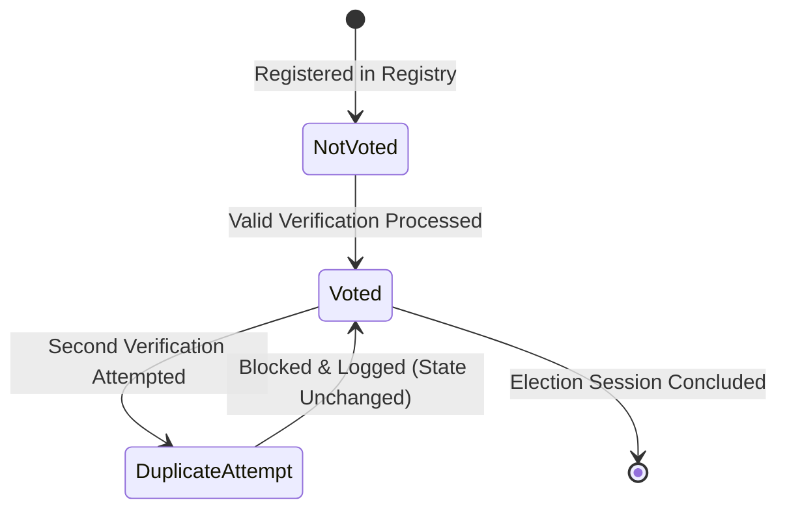
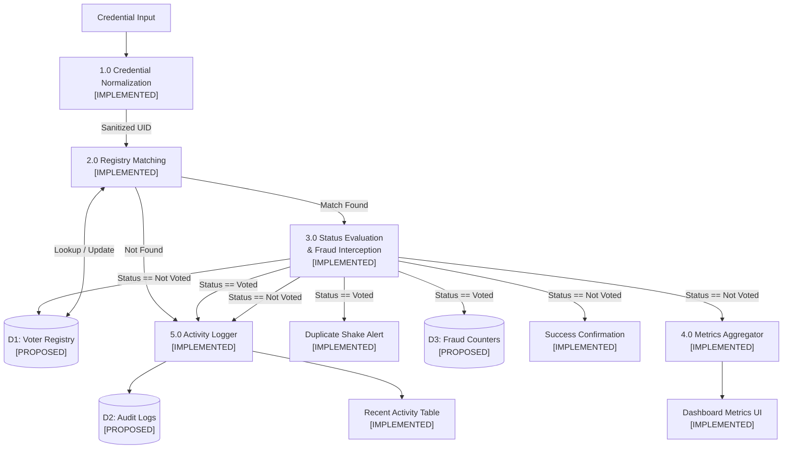
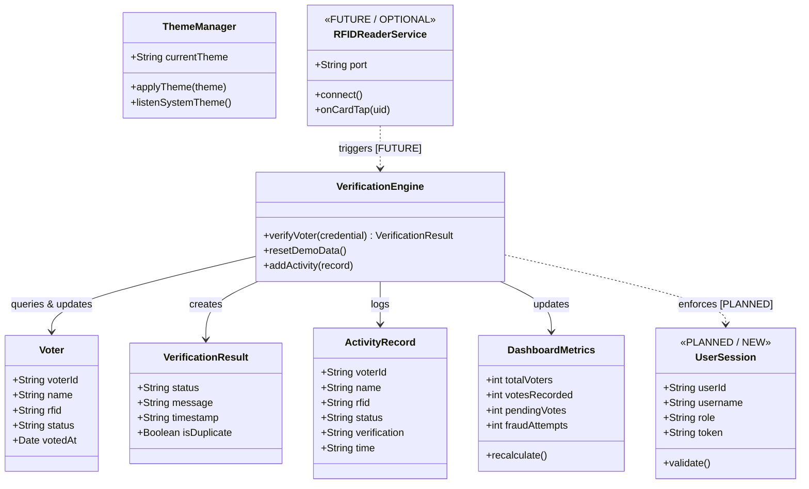
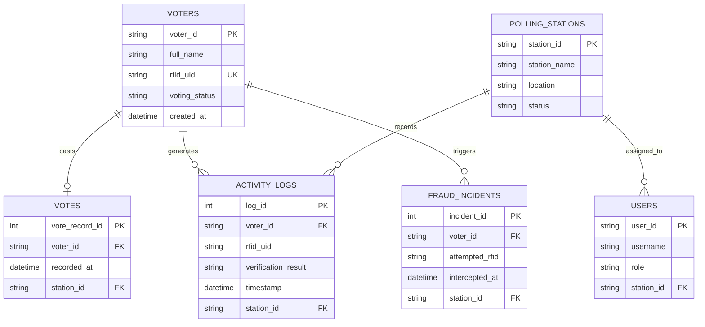
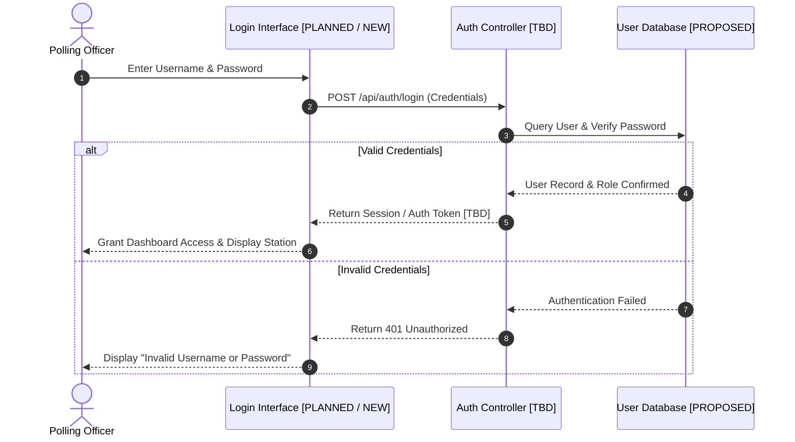
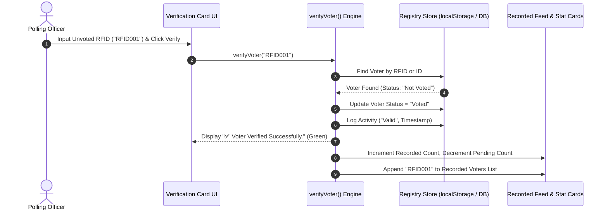
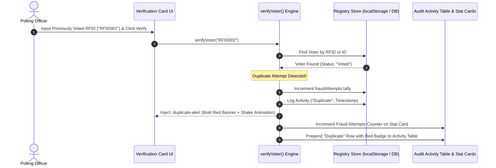
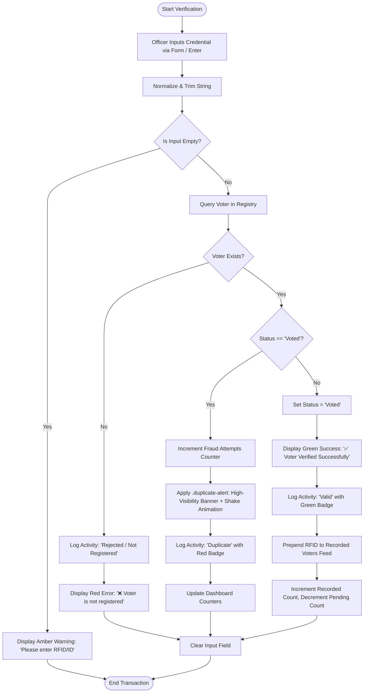
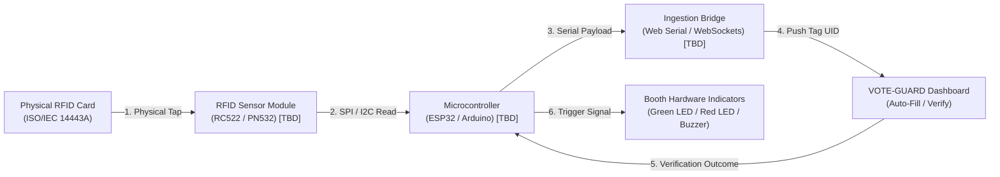

# VOTE-GUARD — System Design & Technical Documentation
## Centralized Voter Verification & Duplicate Voting Attempt Prevention System

> **Document Version:** 1.0.0  
> **Classification:** Project Engineering Specification & Academic Documentation  
> **Status:** Current Client-Side Prototype with Proposed Backend & Database Architecture  
> **Author:** VOTE-GUARD Engineering Team  
> **Date:** October 2026  

---

> ### ⚠️ Official Project Status & Terminology Statement
> **VOTE-GUARD is currently a client-side voting security and voter verification prototype.**  
> It simulates voter verification and voting status using browser-based client storage (`localStorage`) for demonstration and testing purposes. It **does not** perform real electronic voting, nor is it an official government election platform in its current state.  
> 
> * **Current Prototype:** A browser-based demonstration simulating voter verification and voting-status management.
> * **Future Connected System:** A centralized voter verification and duplicate-attempt prevention system deployed across authenticated polling stations.
> * **Classification Standard:**
>   * `[IMPLEMENTED]` – Currently working in the existing HTML5/CSS3/JavaScript prototype.
>   * `[PLANNED / NEW]` – Features intended for the upcoming connected system.
>   * `[FUTURE / OPTIONAL]` – Possible long-term extensions (hardware RFID sensors, biometrics, multi-booth synchronization).
>   * `[PROPOSED]` – Conceptual database, domain, and architectural designs that are not yet implemented or finalized.
>   * `[TBD]` – Technology or architecture decisions that the project team has not yet finalized.

---

## TABLE OF CONTENTS

1. [Introduction](#1-introduction)
2. [Problem Statement](#2-problem-statement)
3. [Objectives](#3-objectives)
4. [Scope](#4-scope)
5. [Existing System](#5-existing-system)
6. [Existing System Limitations](#6-existing-system-limitations)
7. [Proposed System](#7-proposed-system)
8. [Functional Requirements](#8-functional-requirements)
9. [Non-Functional Requirements](#9-non-functional-requirements)
10. [System Workflow](#10-system-workflow)
11. [Use Case Model & Diagram](#11-use-case-model--diagram)
12. [Data Flow Diagrams (DFD Level 0 & Level 1)](#12-data-flow-diagrams-dfd-level-0--level-1)
13. [Class Diagram](#13-class-diagram)
14. [Entity-Relationship (ER) Diagram [PROPOSED]](#14-entity-relationship-er-diagram-proposed)
15. [Sequence Diagrams](#15-sequence-diagrams)
16. [Activity Diagram](#16-activity-diagram)
17. [System Architecture](#17-system-architecture)
18. [Database Design [PROPOSED]](#18-database-design-proposed)
19. [Module Design](#19-module-design)
20. [Future IoT / RFID Integration [FUTURE / OPTIONAL]](#20-future-iot--rfid-integration-future--optional)
21. [Security Requirements](#21-security-requirements)
22. [Technology Decision Register](#22-technology-decision-register)
23. [Current vs. Planned vs. Future Feature Matrix](#23-current-vs-planned-vs-future-feature-matrix)
24. [Limitations](#24-limitations)
25. [Future Scope](#25-future-scope)
26. [Conclusion](#26-conclusion)
27. [References](#27-references)

---

## 1. INTRODUCTION

### 1.1 Project Overview
**VOTE-GUARD is currently a client-side voting security and voter verification prototype.** The application was engineered to address one of the most critical vulnerabilities in modern electoral processes: the detection and immediate mitigation of **duplicate voting attempts**. By providing real-time accreditation checks against registered credentials, VOTE-GUARD enables polling supervisors to verify whether a credential has already been marked as voted, inspect verification activity trails, and monitor station activity metrics.

### 1.2 Background & Motivation
In paper-based accreditation procedures and disconnected voting kiosks, verifying whether an elector has already voted across disparate registration books or multiple booths is prone to human oversight, verification delays, and identity impersonation. VOTE-GUARD was conceptualized as a modern digital verification gatekeeper that sits between the voter intake line and the voting booth, ensuring that only verified, unvoted electors proceed.

### 1.3 Terminology & Definitions
To maintain academic rigor and avoid confusion regarding real-world electronic voting machines (EVMs), the following distinctions are established:
* **Voter Verification:** The algorithmic lookup and validation of an elector's registered credential (RFID tag UID or alphanumeric Voter ID).
* **Voting Status:** A binary accreditation flag indicating whether the citizen is currently marked as `"Not Voted"` or `"Voted"`.
* **Duplicate Voting Attempt Detection:** The real-time interception of a credential whose status is already recorded as `"Voted"`, triggering security alerts and incrementing fraud metrics.
* **Simulated Vote / Verification Record:** The demonstration state transition recorded within the system indicating that verification occurred successfully.
* **Real Electronic Voting System:** An end-to-end statutory voting platform handling secret ballots, vote tallying, and certified election results (distinct from and outside the scope of this project).

### 1.4 Purpose and Target Audience
This document serves as the comprehensive engineering specification for VOTE-GUARD. It is prepared for academic faculty evaluation, software engineering project reviews, and as the authoritative technical reference for the future transition from the client-side prototype to a full client-server connected system.

---

## 2. PROBLEM STATEMENT

### 2.1 Challenges in Manual Voter Accreditation
Traditional manual voter accreditation relies heavily on physical voter rolls printed on paper. Election officers manually cross out names or verify indelibly inked fingers. This workflow is subject to:
1. **Human Fatigue & Oversight:** Manual verification in high-volume queues leads to clerical errors and identity mix-ups.
2. **Slow Verification Latency:** Searching alphabetical indexes manually causes long queues and voter disenfranchisement.
3. **Lack of Instant Inter-Desk Communication:** In multi-desk polling stations, an elector crossing between desks cannot be instantly verified without a synchronized digital ledger.

### 2.2 The Risk of Duplicate Voting Attempts
Duplicate voting occurs when an elector attempts to cast more than one ballot using cloned cards, stolen IDs, or multiple registrations across different booths. Without instant verification, duplicate attempts may go undetected until post-election audits, compromising the legitimacy of the electoral process.

### 2.3 Single-Station Data Silos
Existing standalone kiosk prototypes store operational data locally on individual devices. When multiple stations operate without a shared backend, transactions on Station A remain completely invisible to Station B, creating vulnerabilities during parallel polling operations.

---

## 3. OBJECTIVES

### 3.1 Primary Verification Objectives
* Implement instant algorithmic verification of voter credentials (RFID UID / Voter ID). `[IMPLEMENTED]`
* Provide unambiguous visual feedback: Valid voter acceptance vs. duplicate attempt interception. `[IMPLEMENTED]`
* Maintain a real-time count of recorded voter credentials within the active session. `[IMPLEMENTED]`

### 3.2 Security & Fraud Prevention Goals
* Intercept every duplicate voting attempt and trigger high-visibility alerts. `[IMPLEMENTED]`
* Increment and persist an audit counter of unauthorized duplicate attempts. `[IMPLEMENTED]`
* Log tamper-evident audit records containing voter identification, timestamp, and verification outcome. `[PLANNED / NEW]`

### 3.3 Prototype Demonstration Goals vs. Production Objectives
* **Prototype Goal:** Provide a responsive, zero-installation browser dashboard using `localStorage` to validate the verification UX and fraud alerting model. `[IMPLEMENTED]`
* **Production Objective:** Transition to a centralized, multi-tier client-server architecture with persistent database storage, atomic concurrency locks, and hardware sensor ingestion. `[PLANNED / NEW]`

---

## 4. SCOPE

### 4.1 In-Scope (Current Client-Side Prototype) `[IMPLEMENTED]`
* Single-page responsive web dashboard (`index.html`, `style.css`, `script.js`).
* Manual credential entry simulating RFID tag scanning and Voter ID input.
* In-memory/localStorage registry lookup supporting case-insensitive queries.
* Real-time metric calculations (Total, Recorded, Pending, Fraud Attempts) isolated to the local browser session.
* Animated alert banner for duplicate voting attempts (`@keyframes duplicateAlertShake`).
* Live audit feed showing the latest 10 verification transactions.
* Multi-theme switcher supporting Light mode, Dark mode, and Windows System theme sync.
* Demo reset facility restoring factory mock data.

### 4.2 In-Scope (Planned Connected System) `[PLANNED / NEW]`
* Centralized backend server and database replacing browser `localStorage`.
* Polling Officer authentication and station authorization.
* Atomic verification transactions preventing race conditions across multiple booths.
* Persistent, tamper-evident audit storage.

### 4.3 Out-of-Scope (Official Election Machinery)
* Official statutory vote casting, candidate ballot creation, and electoral vote counting.
* Cryptographic voter anonymity layers (e.g., zero-knowledge proofs or homomorphic encryption for secret ballots).
* National-scale voter database synchronization.

---

## 5. EXISTING SYSTEM

### 5.1 Overview of Current Prototype
The current VOTE-GUARD system is a lightweight, zero-dependency client-side prototype. It runs directly within modern web browsers and executes business logic entirely in client-side JavaScript.

### 5.2 User Interface Structure
The dashboard interface is structured into four primary visual zones:
1. **Sticky Navigation Bar (`.navbar`):** Displays the project brand (`🛡️ VOTE-GUARD`), a borderless theme selector dropdown, the static role indicator (`Admin`), and a demo Logout button.
2. **Page Heading & Status:** Contains the page title, description, and an active pulse indicator (`System Online`).
3. **Stat Cards Grid (`.stats-container`):** Four responsive metric cards:
   * **Total Voters (`#totalVoters`):** Total voters in the active registry.
   * **Votes Recorded (`#votesRecorded`):** Total verified electors marked as `"Voted"`.
   * **Pending Votes (`#pendingVotes`):** Calculated difference (`Total - Recorded`).
   * **Fraud Attempts (`#fraudAttempts`):** Cumulative count of intercepted duplicate attempts.
4. **Main Verification Grid (`.main-grid`):**
   * **Voter Verification Card:** Input field (`#voterInput`), verification button (`#verifyBtn`), RFID badge, and dynamic notification container (`#verificationMessage`).
   * **Recorded Voters Card:** Real-time count badge (`#recordedCount`) and vertical list displaying RFID tags of electors who have already verified.
5. **Recent Verification Activity Section (`.recent-section`):** A responsive audit table displaying the last 10 verification transactions with color-coded status badges, alongside a "Reset Demo" button.

### 5.3 Client-Side Storage & Data Simulation Engine
Data persistence is managed via the browser's `localStorage` API:
* `voteGuardVoters`: Serialized JSON array of voter objects initialized from a seed list of 6 electors.
* `voteGuardFraudAttempts`: Integer counter tracking blocked duplicate attempts.
* `voteGuardActivities`: Serialized JSON array containing up to 10 activity log entries.
* `voteGuardTheme`: String indicating selected theme (`"light"`, `"dark"`, or `"system"`).

### 5.4 Theme Controller
The interface includes a theme controller:
* Native light mode with clean contrast (`#f5f8fc` background, `#17233c` text).
* Deep dark mode (`[data-theme="dark"]`) using navy/slate tones (`#0d1527` background, `#131f37` cards).
* Real-time Windows system theme integration via `window.matchMedia("(prefers-color-scheme: dark)")`.
* Flash-of-unstyled-content (FOUC) prevention via an inline initialization script in `<head>`.

---

## 6. EXISTING SYSTEM LIMITATIONS

### 6.1 Absence of Server-Side Enforcement
The current prototype contains no backend server. All lookup and status-updating algorithms execute client-side in `script.js`. Any user can bypass or manipulate the logic via browser developer tools.

### 6.2 Client-Side Storage Vulnerabilities
`localStorage` stores unencrypted plaintext data accessible to anyone with physical access to the browser console. A user can clear or modify voter statuses and fraud counters with a single JavaScript command.

### 6.3 Single-Station Isolation
Metrics and verification statuses are strictly real-time within the single browser tab. There is **no synchronization** across multiple computers, polling stations, or browsers. If Station A verifies an elector, Station B has no knowledge of it.

### 6.4 Lack of User Authentication & Session Security
The "Admin" label in the navigation bar is purely static visual text. There is no login screen, no password verification, no session token, and no cryptographic authentication.

### 6.5 Manual RFID/Voter ID Emulation
The system requires an operator to manually type or paste an RFID UID or Voter ID into an input box. There is currently no hardware interface connecting physical RFID scanning hardware to the application.

---

## 7. PROPOSED SYSTEM

### 7.1 Architectural Vision: Centralized Voter Verification & Duplicate-Attempt Prevention System
The proposed system transitions VOTE-GUARD into a secure, multi-tier client-server architecture. The existing HTML5/CSS3 frontend is retained as the presentation interface, while state management, verification logic, and audit logging are transferred to a secure server.

### 7.2 Centralized Registry & Atomic Status Updates
When an RFID credential is presented at any polling booth, the request is transmitted to a centralized API. The backend executes an atomic transaction (e.g., row-level locking or atomic compare-and-swap) to verify that `status == "Not Voted"`, immediately marking it as `"Voted"` before releasing the lock. This prevents race conditions where two booths attempt to verify the same credential simultaneously.

### 7.3 Multi-Station Consistency & Persistent Audit Logging
All connected polling stations will share a unified database. A duplicate attempt at Booth 2 for a voter verified 5 seconds earlier at Booth 1 will be intercepted and flagged across the network.

---

## 8. FUNCTIONAL REQUIREMENTS

| Identifier | Requirement Description | Classification | Prototype Behavior vs. Target Scope |
| :--- | :--- | :--- | :--- |
| **FR-01** | Input credential via text input (RFID or Voter ID) | `[IMPLEMENTED]` | Manually entered in `#voterInput` and triggered via Button/Enter. |
| **FR-02** | Automatic string sanitization & normalization | `[IMPLEMENTED]` | Whitespace trimmed, uppercase converted in client script. |
| **FR-03** | Query voter registry by RFID or Voter ID | `[IMPLEMENTED]` | Case-insensitive array search over local dataset. |
| **FR-04** | Detection and interception of duplicate voting attempts | `[IMPLEMENTED]` | Checks if `status === "Voted"`, blocks verification, triggers alert. |
| **FR-05** | High-visibility animated duplicate attempt alert | `[IMPLEMENTED]` | Renders `.duplicate-alert` box with red border and shake animation. |
| **FR-06** | Browser-isolated real-time Total Voters metric | `[IMPLEMENTED]` | Live count calculated from local array length in active browser. |
| **FR-07** | Browser-isolated real-time Votes Recorded metric | `[IMPLEMENTED]` | Live count of voters marked "Voted" in active browser. |
| **FR-08** | Browser-isolated real-time Pending Votes metric | `[IMPLEMENTED]` | Dynamically calculated (`Total - Recorded`) in active browser. |
| **FR-09** | Browser-isolated real-time Fraud Attempts counter | `[IMPLEMENTED]` | Cumulative counter incremented on duplicate attempts. |
| **FR-10** | Recorded voters RFID feed | `[IMPLEMENTED]` | Dynamic list of RFID tags rendered in `#recordedVotersTable`. |
| **FR-11** | Tabular verification activity log (latest 10) | `[IMPLEMENTED]` | Audit table showing ID, Name, RFID, Status, Result, and Time. |
| **FR-12** | Polling Officer authentication & login | `[PLANNED / NEW]` | Currently static text; will authenticate against server credentials. |
| **FR-13** | Session token validation & automatic expiry | `[PLANNED / NEW]` | Server-validated session integrity for polling booth operators. |
| **FR-14** | Demo state reset capability | `[IMPLEMENTED]` | Resets mock voter statuses, fraud count, and logs to baseline. |
| **FR-15** | Multi-theme switching (Light, Dark, Windows System)| `[IMPLEMENTED]` | Borderless navbar dropdown with `prefers-color-scheme` listener. |
| **FR-16** | Fully responsive presentation layout | `[IMPLEMENTED]` | CSS Grid and Flexbox adapting across 320px–1920px viewports. |

---

## 9. NON-FUNCTIONAL REQUIREMENTS

* **NFR-01: Data Integrity & Concurrency Controls `[PLANNED / NEW]`:**  
  The verification of a credential must be atomic. No concurrent verification of the same RFID tag across separate stations may both succeed.
* **NFR-02: Verification Turnaround Latency `[IMPLEMENTED]`:**  
  In the current client-side prototype, verification latency is sub-10ms. In the proposed connected system, the API response must complete in under 200ms under standard local network conditions.
* **NFR-03: Visual Clarity & Alert Prominence `[IMPLEMENTED]`:**  
  Duplicate voting alerts must be immediately discernible under varying lighting conditions, utilizing distinct high-contrast colors, icons, and CSS animations.
* **NFR-04: Cross-Browser Compatibility `[IMPLEMENTED]`:**  
  The interface must function identically across all modern standards-compliant web browsers (Chromium/Chrome, Edge, Firefox, Safari).
* **NFR-05: Fault Tolerance & Graceful Fallback `[PLANNED / NEW]`:**  
  If network connectivity to the central server is interrupted, the client dashboard must indicate an offline warning state and prevent unverified admissions.
* **NFR-06: Zero Flash of Unstyled Content (FOUC) `[IMPLEMENTED]`:**  
  Theme selection must apply before the initial page paint to prevent white flash when opening dark mode.

---

## 10. SYSTEM WORKFLOW

### 10.1 System Lifecycle
1. **Initialization:** The browser loads `index.html`. The early theme script reads `voteGuardTheme` from `localStorage` and applies the theme attribute to `<html>`.
2. **Data Hydration:** `script.js` retrieves registry data, fraud metrics, and activity logs from `localStorage`. If empty, it seeds mock defaults (`defaultVoters`).
3. **Dashboard Render:** `updateDashboard()` recalculates counts, renders metric cards, populates `#recordedVotersTable`, and renders `#activityTable`.
4. **Event Listening:** Event listeners attach to `#verifyBtn`, `#voterInput` (Enter key), `#resetBtn`, and `#themeSelect`.
5. **Verification Execution:** When an input is entered, `verifyVoter()` executes the decision tree.

### 10.2 State Machine
The elector verification lifecycle follows an irreversible one-way transition per election:



---

## 11. USE CASE MODEL & DIAGRAM

### 11.1 Actor Definitions
* **Polling Officer:** The active primary user operating the verification kiosk.
* **Voter (Passive):** The citizen presenting an RFID or Voter ID credential.
* **System Administrator:** An administrative actor responsible for election reset and audit review.
* **Physical RFID Reader `[FUTURE / OPTIONAL]`:** An external sensor device streaming scanned card UIDs.

### 11.2 Use Case Specifications
* **UC-01: Verify Voter Identity `[IMPLEMENTED]`** – Officer submits credential; system checks registry and marks as Voted if eligible.
* **UC-02: Intercept Duplicate Voting Attempt `[IMPLEMENTED]`** – System detects previously voted status, blocks admission, triggers visual alert, increments counter.
* **UC-03: View Summary Metrics `[IMPLEMENTED]`** – Officer monitors live dashboard counters for total, recorded, pending, and fraud tallies.
* **UC-04: View Activity Logs `[IMPLEMENTED]`** – Officer audits the chronological transaction log of the last 10 verification attempts.
* **UC-05: Toggle Visual Theme `[IMPLEMENTED]`** – Officer adjusts display mode between Light, Dark, or Windows System scheme.
* **UC-06: Reset Demo Data `[IMPLEMENTED]`** – Officer/Admin resets the voter database back to initial demonstration state.
* **UC-07: Authenticate Officer Session `[PLANNED / NEW]`** – Officer logs in using credentials to start an authorized verification session.
* **UC-08: Stream Physical RFID Card Tap Event `[FUTURE / OPTIONAL]`** – IoT hardware scans physical card and inputs UID automatically.

### 11.3 Use Case Diagram
```mermaid
flowchart LR
    subgraph Boundary["VOTE-GUARD Verification Boundary"]
        UC1((UC-01: Verify Voter Identity<br>[IMPLEMENTED]))
        UC2((UC-02: Intercept Duplicate Attempt<br>[IMPLEMENTED]))
        UC3((UC-03: View Summary Metrics<br>[IMPLEMENTED]))
        UC4((UC-04: View Activity Logs<br>[IMPLEMENTED]))
        UC5((UC-05: Toggle Visual Theme<br>[IMPLEMENTED]))
        UC6((UC-06: Reset Demo State<br>[IMPLEMENTED]))
        UC7((UC-07: Authenticate Officer<br>[PLANNED / NEW]))
        UC8((UC-08: Stream Physical Card Tap<br>[FUTURE / OPTIONAL]))
    end

    Officer["Polling Officer"]
    Admin["System Administrator"]
    IoT["IoT RFID Reader<br>[FUTURE / OPTIONAL]"]

    Officer --> UC1
    Officer --> UC2
    Officer --> UC3
    Officer --> UC4
    Officer --> UC5
    Officer --> UC7
    
    Admin --> UC3
    Admin --> UC6
    Admin --> UC7

    IoT --> UC8
    UC8 -.->|triggers| UC1
```

---

## 12. DATA FLOW DIAGRAMS

### 12.1 Context Diagram / DFD Level 0
```mermaid
flowchart TD
    Officer["Polling Officer"]
    System["0.0<br>VOTE-GUARD System"]
    Storage[("Client Storage / Database<br>[PROPOSED]")]

    Officer -->|1. Enters RFID / Voter ID| System
    Officer -->|2. Theme Selection| System
    Officer -->|3. Demo Reset Request| System
    Officer -.->|4. Login Credentials [PLANNED / NEW]| System

    System -->|5. Verification Alert (Valid / Duplicate / Unregistered)| Officer
    System -->|6. Summary Metrics & Activity Table| Officer

    System <-->|Read / Write Registry & Audit Logs| Storage
```

### 12.2 DFD Level 1 (Process Decomposition)


---

## 13. CLASS DIAGRAM



---

## 14. ENTITY-RELATIONSHIP (ER) DIAGRAM [PROPOSED]

> **Note:** The entities, attributes, and relationships depicted below represent a conceptual design `[PROPOSED]`. No specific relational (SQL) or document (NoSQL) database engine has been selected.



---

## 15. SEQUENCE DIAGRAMS

### 15.1 Polling Officer Authentication Flow `[PLANNED / NEW]`
*This sequence diagram models the planned authentication subsystem.*



### 15.2 Successful Voter Verification Flow
*Models the workflow currently running in the client prototype.*



### 15.3 Duplicate Verification Interception Flow
*Models duplicate detection and the high-visibility alert animation.*



---

## 16. ACTIVITY DIAGRAM



---

## 17. SYSTEM ARCHITECTURE

### 17.1 Architecture Comparison
* **Current Prototype Architecture `[IMPLEMENTED]`:**  
  A single-tier presentation architecture. All UI rendering, verification state machines, and data stores reside entirely inside the client browser.
* **Proposed Multi-Tier Architecture `[PLANNED / NEW]`:**  
  A decoupled client-server architecture consisting of a Presentation Tier (existing UI), an Application Logic/API Tier `[TBD]`, and a Persistence Tier `[TBD]`.

### 17.2 Architecture Diagram
```mermaid
flowchart TB
    subgraph ClientTier["Presentation Tier [IMPLEMENTED]"]
        Browser["Modern Web Browser"]
        Dashboard["Dashboard View (index.html)"]
        Styles["Theme & Alert Styling (style.css)"]
        Controller["DOM & Verification Controller (script.js)"]
        Browser --> Dashboard
        Browser --> Styles
        Browser --> Controller
    end

    subgraph CurrentData["Prototype Data Storage [IMPLEMENTED]"]
        LocalStore[("Browser localStorage<br>voteGuardVoters<br>voteGuardFraudAttempts<br>voteGuardActivities")]
        Controller <-->|Direct Read/Write| LocalStore
    end

    subgraph ProposedServerTier["Application Tier [TBD / PLANNED]"]
        APIServer["API Gateway & Service Layer [TBD]"]
        AuthModule["Authentication & Session Service [TBD]"]
        VerifyService["Atomic Verification Service [TBD]"]
        APIServer --> AuthModule
        APIServer --> VerifyService
    end

    subgraph ProposedDataTier["Persistence Tier [TBD / PROPOSED]"]
        CentralDB[("Centralized Database [TBD]<br>Voters | Activity Logs | Fraud Stats")]
        VerifyService <--> CentralDB
        AuthModule <--> CentralDB
    end

    subgraph FutureIoTTier["Hardware Tier [FUTURE / OPTIONAL]"]
        RFIDCard["Physical RFID Card"]
        Reader["RFID Sensor (RC522 / PN532) [TBD]"]
        MCU["Microcontroller (ESP32 / Arduino) [TBD]"]
        Bridge["Serial / WebSocket Bridge [TBD]"]
        RFIDCard --> Reader --> MCU --> Bridge
    end

    Controller -.->|Target API Calls [PLANNED]| APIServer
    Bridge -.->|Auto-Fill / Scan Stream [FUTURE]| Controller
```

---

## 18. DATABASE DESIGN [PROPOSED]

> **Note:** The schemas below are conceptual representations `[PROPOSED]` to guide future database implementation. No database engine (MySQL, PostgreSQL, MongoDB, SQLite, etc.) has been selected yet.

### 18.1 Proposed Entity Schemas

#### 1. Table: `voters` `[PROPOSED]`
Stores registered electors eligible to participate in the simulation.
* `id`: Primary Key (UUID or Auto-Increment Integer).
* `voter_id`: Unique Alphanumeric Identifier (e.g., `"V001"`).
* `name`: Full Name of the voter (e.g., `"Rahul Sharma"`).
* `rfid`: Unique RFID Tag Identifier (e.g., `"RFID001"`).
* `status`: Current voting status (`"Not Voted"` or `"Voted"`).
* `voted_at`: Nullable Timestamp recording when the elector was verified.

#### 2. Table: `activity_logs` `[PROPOSED]`
Records every verification transaction chronologically.
* `log_id`: Primary Key.
* `voter_id`: Alphanumeric Identifier (or `"N/A"` for unregistered).
* `name`: Name of voter (or `"Unknown Voter"`).
* `rfid`: RFID credential submitted.
* `status`: Voter status at time of scan.
* `verification`: Verification outcome (`"Valid"`, `"Duplicate"`, `"Rejected"`).
* `timestamp`: Precise transaction timestamp.
* `station_id`: Optional identifier for the booth station.

#### 3. Table: `fraud_incidents` `[PROPOSED]`
Dedicated audit table tracking unauthorized duplicate attempts.
* `incident_id`: Primary Key.
* `voter_id`: Foreign Key referencing `voters.voter_id`.
* `attempted_rfid`: RFID string scanned during duplicate attempt.
* `intercepted_at`: Timestamp of interception.
* `station_id`: Terminal identifier where duplicate was blocked.

#### 4. Table: `polling_stations` `[PROPOSED]`
Tracks authorized polling desks in multi-station deployments.
* `station_id`: Primary Key.
* `station_name`: Descriptive station identifier (e.g., `"Booth Desk 01"`).
* `location`: Venue/Room identifier.
* `is_active`: Boolean indicating active status.

#### 5. Table: `users` `[PROPOSED]`
Stores administrative and officer credentials for system access.
* `user_id`: Primary Key.
* `username`: Officer username.
* `password_hash`: Cryptographically hashed password.
* `role`: User role (`"Officer"` or `"Administrator"`).

---

## 19. MODULE DESIGN

### 19.1 Presentation Controller `[IMPLEMENTED]`
* **File:** `script.js` / `index.html`
* **Responsibilities:** Manages DOM element references, binds user event listeners (click, keypress, dropdown change), renders dynamic HTML for stat cards, recorded list, and activity table.

### 19.2 Verification Engine `[IMPLEMENTED]`
* **File:** `script.js` (`verifyVoter()`)
* **Responsibilities:** Implements validation branching logic, evaluates voting status, increments fraud tallies, applies the `.duplicate-alert` class with CSS shake animation, and records transaction entries.

### 19.3 State & Storage Adapter
* **Current Mode `[IMPLEMENTED]`:** Synchronous read/write operations against browser `localStorage`.
* **Planned Mode `[PLANNED / NEW]`:** Asynchronous HTTP/REST client utilizing `fetch()` to communicate with backend endpoints (`/api/voters`, `/api/verify`, `/api/stats`).

### 19.4 Theme Controller `[IMPLEMENTED]`
* **File:** `index.html` (inline `<head>` script) and `script.js`
* **Responsibilities:** Intercepts theme selection, dynamically queries `prefers-color-scheme`, updates `data-theme` attribute on `<html>`, and stores preference in `voteGuardTheme`.

### 19.5 Security & Authentication Interceptor `[PLANNED / NEW]`
* **Status:** `[PLANNED / NEW]`
* **Responsibilities:** Intercepts outgoing requests, attaches session credentials, enforces role-based view permissions, and handles automatic session expiration.

---

## 20. FUTURE IoT / RFID INTEGRATION [FUTURE / OPTIONAL]

> **Status:** All physical hardware components, sensors, microcontrollers, and communication protocols discussed in this section are classified as `[FUTURE / OPTIONAL]` and `[TBD]`. No hardware decisions have been finalized.

### 20.1 Hardware Components `[TBD / FUTURE / OPTIONAL]`
* **RFID Transponder:** 13.56 MHz High-Frequency contactless smart cards / key fobs (ISO/IEC 14443A).
* **RFID Reader Module:** Contactless reader module (e.g., MFRC522 or PN532 NFC reader) `[TBD]`.
* **Microcontroller Unit (MCU):** Development board (e.g., ESP32, Arduino Uno/Nano, Raspberry Pi) `[TBD]`.

### 20.2 Ingestion Protocols `[TBD / FUTURE / OPTIONAL]`
* **Web Serial API:** Enables the web browser to communicate directly with USB-connected serial microcontrollers without local server software.
* **WebSocket Daemon:** A lightweight background agent reading serial data from COM ports and broadcasting scanned UIDs over WebSockets.
* **MQTT Message Broker:** Network protocol for distributed polling booths emitting card tap events to a centralized broker.

### 20.3 Future IoT Architecture Diagram


---

## 21. SECURITY REQUIREMENTS

* **21.1 Identity Spoofing Mitigation:**  
  Prevent unauthorized manual entry of arbitrary ID strings by validating credential formats and checking against the registered database.
* **21.2 Race-Condition Mitigation `[PLANNED / NEW]`:**  
  In multi-booth deployments, concurrent verification attempts for the exact same credential must be handled via atomic transactions to prevent double-accreditation.
* **21.3 Persistent and Tamper-Evident Audit Storage `[PLANNED / NEW]`:**  
  Audit records must be stored in a centralized, secure database that prevents retrospective modification or local tampering.
* **21.4 Authentication Mechanism `[TBD / PLANNED / NEW]`:**  
  Authentication mechanism: **TBD** — to be selected after backend and system architecture review.

---

## 22. TECHNOLOGY DECISION REGISTER

| Layer | Component | Status | Specification / Notes |
| :--- | :--- | :--- | :--- |
| **Frontend UI** | Markup Structure | `[IMPLEMENTED]` | **HTML5** semantic tags (`index.html`). |
| **Frontend UI** | Styling & Visual Themes | `[IMPLEMENTED]` | **CSS3** with variables, Grid, Flexbox, Animations (`style.css`). |
| **Frontend UI** | Client-Side Controller | `[IMPLEMENTED]` | **Vanilla JavaScript (ES6+)** (`script.js`). |
| **Prototype Storage** | Local State Cache | `[IMPLEMENTED]` | **Browser localStorage** (temporary prototype storage). |
| **Backend Runtime** | Server Environment | `[TBD]` | *Pending team decision.* No language or runtime assumed. |
| **Backend Framework** | Web / REST Framework | `[TBD]` | *Pending team decision.* |
| **Database Engine** | Storage System | `[TBD]` | *Pending team decision.* (Relational vs. Document model open). |
| **ORM / Data Access** | Database Layer | `[TBD]` | *Pending team decision.* |
| **Authentication** | Officer Credentials & Session | `[TBD]` | *Pending team decision.* (Mechanism TBD). |
| **Hardware MCU** | Physical Microcontroller | `[TBD]` | *Pending team decision.* (Future hardware scope). |
| **Hardware Sensor** | RFID/NFC Module | `[TBD]` | *Pending team decision.* (Future hardware scope). |
| **IoT Protocol** | Hardware Communication | `[TBD]` | *Pending team decision.* (Future hardware scope). |

---

## 23. CURRENT VS. PLANNED VS. FUTURE FEATURE MATRIX

| Feature / Subsystem | Implemented Status | Description & Operational Scope |
| :--- | :--- | :--- |
| **Credential Input Box** | `[IMPLEMENTED]` | Text input field for manual RFID / Voter ID entry with Enter key support. |
| **String Sanitization** | `[IMPLEMENTED]` | Automated trimming and uppercase conversion in client JavaScript. |
| **Registry Search** | `[IMPLEMENTED]` | Case-insensitive lookup matching registered voter records. |
| **Duplicate Voting Detection** | `[IMPLEMENTED]` | Interception of previously voted records with instant failure routing. |
| **High-Visibility Alert** | `[IMPLEMENTED]` | Bold red banner with glowing accent bar and CSS shake animation. |
| **Real-Time Stat Counters** | `[IMPLEMENTED]` | Total, Recorded, Pending, and Fraud Attempt counters (browser-isolated). |
| **Recorded Voters Feed** | `[IMPLEMENTED]` | Live vertical list displaying RFID tags of electors who have voted. |
| **Recent Activity Log** | `[IMPLEMENTED]` | Chronological table of latest 10 transactions with color-coded badges. |
| **Demo Data Reset** | `[IMPLEMENTED]` | Reset button with confirmation dialog restoring baseline mock state. |
| **Theme Switching** | `[IMPLEMENTED]` | Borderless dropdown supporting Light, Dark, and Windows System theme sync. |
| **Responsive Web Layout** | `[IMPLEMENTED]` | Fluid presentation layout scaling across mobile, tablet, and desktop. |
| **Polling Officer Authentication**| `[PLANNED / NEW]` | Secure login screen and credential validation for booth supervisors. |
| **Centralized Database Storage** | `[PLANNED / NEW]` | Shared server database replacing client-side `localStorage`. |
| **Atomic Concurrency Locks** | `[PLANNED / NEW]` | Server-side race-condition prevention across simultaneous booth checks. |
| **Persistent Audit Storage** | `[PLANNED / NEW]` | Persistent and tamper-evident audit storage in central database. |
| **Database Schema Definitions** | `[PROPOSED]` | Proposed conceptual schemas for Voters, Activity, Fraud, Stations, Users. |
| **Physical RFID Scanner** | `[FUTURE / OPTIONAL]` | Hardware sensor scanning physical 13.56MHz cards automatically. |
| **Hardware Signal Feedback** | `[FUTURE / OPTIONAL]` | Physical LED lights (Green/Red) and buzzer attached to polling booth. |
| **Multi-Booth Live Sync** | `[FUTURE / OPTIONAL]` | Instant cross-booth synchronization across distributed polling locations. |
| **Biometric Multi-Factor Match** | `[FUTURE / OPTIONAL]` | Secondary biometric verification (fingerprint / facial verification). |

---

## 24. LIMITATIONS

1. **Client-Side Prototype Constraints:** All current logic operates inside the user's browser; clearing browser cache clears mock voter statuses and activity logs.
2. **Single-Browser Isolation:** Current metrics are real-time only within the single browser tab. Changes do not sync across different machines.
3. **Absence of Real Security Enforcement:** Without a server-side authentication layer, client-side data can be viewed or altered using browser DevTools.
4. **Manual Hardware Emulation:** The current prototype requires manual typing or pasting of tags rather than receiving real-time contactless sensor events.

---

## 25. FUTURE SCOPE

1. **Backend & Database Realization:** Development of the centralized API layer and persistent database using technologies chosen in the Decision Register.
2. **Physical IoT Sensor Enclosure:** Construction of a standalone verification terminal featuring a microcontroller, RFID sensor, status OLED display, and buzzer.
3. **Multi-Station Polling Network:** Distributed synchronization allowing dozens of registration desks within an election precinct to verify electors concurrently.
4. **Multi-Factor Biometric Verification:** Integration of fingerprint or facial recognition sensors alongside the RFID credential for high-assurance validation.

---

## 26. CONCLUSION

VOTE-GUARD successfully demonstrates the viability of a real-time voter verification and duplicate voting attempt interception system. Its intuitive interface, animated high-visibility duplicate alerts, and responsive multi-theme presentation establish a solid foundation for electoral security verification. 

By maintaining strict technological neutrality regarding backend, database, and hardware layers, this documentation provides a clear, production-ready blueprint for academic review and upcoming full-stack implementation.

---

## 27. REFERENCES

1. IEEE Standard for Software Quality Assurance Processes (IEEE Std 730-2014).
2. ISO/IEC/IEEE 29148:2018 Systems and Software Engineering — Life Cycle Processes — Requirements Engineering.
3. NIST Special Publication 800-63B: Digital Identity Guidelines — Authentication and Lifecycle Management.
4. W3C Web Content Accessibility Guidelines (WCAG) 2.1.
5. ISO/IEC 14443-1:2018 Identification cards — Contactless integrated circuit cards — Proximity cards.

