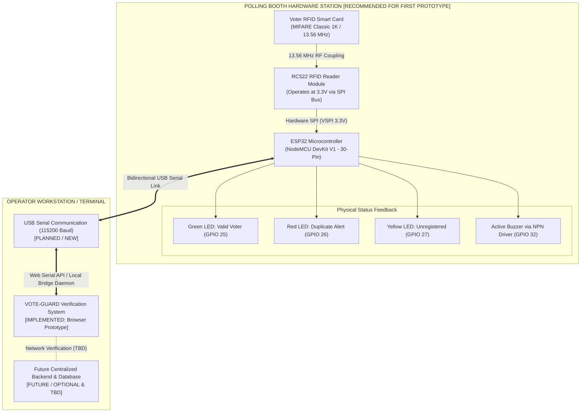

# VOTE-GUARD — First Working Hardware Prototype
## Hardware Requirements & Bill of Materials (BOM)

> **Document Version:** 1.0.0 (Engineering Release)  
> **Project Scope:** First Working Hardware Demonstration Prototype  
> **Status:** Hardware Planning & Component Specification  
> **Author:** VOTE-GUARD Engineering Team  
> **Date:** October 2026  
> **Classification Standard:**  
> • `[IMPLEMENTED]` — Currently functional in the existing client-side HTML/CSS/JavaScript prototype  
> • `[PLANNED / NEW]` — Features intended for the physical hardware and connected integration phase  
> • `[PROPOSED]` — Conceptual hardware architectures, circuits, and schemas under evaluation  
> • `[FUTURE / OPTIONAL]` — Long-term extensions (OLED display, biometrics, custom casing, battery backup)  
> • `[TBD]` — Decisions reserved until further system review (backend framework, database engine)  

---

> ### 🛡️ Official Prototype Scope & Academic Engineering Statement
> **VOTE-GUARD is currently a client-side voter verification and duplicate-attempt detection prototype.**  
> The existing frontend prototype utilizes browser-based local storage (`localStorage`) and manual keyboard input to simulate voter verification.  
> 
> The hardware design specified in this document defines the **First Working Hardware Prototype**. The physical prototype integrates an RFID reader and an embedded microcontroller to capture physical card test credentials and provide immediate sensory feedback (LEDs and buzzer).  
> 
> * **College Prototype Context:** For the prototype, the RFID Unique Identifier (UID) is used as a test identifier mapped to a voter record. UID-based identification alone should not be considered sufficient for secure real-world voter authentication.
> * **Scope of Demonstration:** The prototype demonstrates physical RFID card detection, UID extraction, communication with a host terminal, voter record lookup, instantaneous duplicate-attempt interception, and physical sensory feedback. It does **not** provide production-grade election security or official government voting services.
> * **Backend Neutrality:** Backend technologies (Python, Node.js, Java, FastAPI, Spring Boot) and database engines (MySQL, PostgreSQL, MongoDB, SQLite) remain strictly **`[TBD]`** and are not assumed by this hardware specification.

---

## TABLE OF CONTENTS

1. [Project Hardware Overview](#1-project-hardware-overview)
2. [Hardware Design Principles & Constraints](#2-hardware-design-principles--constraints)
3. [VOTE-GUARD Hardware Requirements](#3-vote-guard-hardware-requirements)
4. [Hardware Architecture](#4-hardware-architecture)
5. [Hardware Component Classification](#5-hardware-component-classification)
6. [Complete Bill of Materials (BOM)](#6-complete-bill-of-materials-bom)
7. [RFID Reader Selection](#7-rfid-reader-selection)
8. [Microcontroller Selection](#8-microcontroller-selection)
9. [Physical Feedback System](#9-physical-feedback-system)
10. [Power Supply & Electrical Requirements](#10-power-supply--electrical-requirements)
11. [Electrical Compatibility & Safety](#11-electrical-compatibility--safety)
12. [Wiring & Pinout Specification](#12-wiring--pinout-specification)
13. [Hardware-to-Software Communication Flow](#13-hardware-to-software-communication-flow)
14. [End-to-End Hardware Workflow](#14-end-to-end-hardware-workflow)
15. [Purchasing Checklist](#15-purchasing-checklist)
16. [Recommended First Prototype Hardware Stack](#16-recommended-first-prototype-hardware-stack)
17. [Estimated Prototype Cost](#17-estimated-prototype-cost)
18. [Future Hardware Expansion](#18-future-hardware-expansion)
19. [Hardware Limitations](#19-hardware-limitations)
20. [Conclusion](#20-conclusion)

---

## 1. PROJECT HARDWARE OVERVIEW

VOTE-GUARD is designed to tackle one of the most critical vulnerabilities in electoral administration: **duplicate voting and voter impersonation at the polling booth**. While traditional paper registers rely on manual line-crossing and indelible ink, VOTE-GUARD demonstrates an automated, tamper-evident verification barrier.

The current working system exists as an interactive client-side web application `[IMPLEMENTED]`, where a polling officer manually enters voter credentials to simulate eligibility verification, status locking, and duplicate-attempt detection. 

To bridge the gap between software simulation and real-world deployment, the project team has decided to prioritize building the **First Working Hardware Prototype** before selecting or implementing a centralized backend infrastructure. This hardware prototype introduces a physical RFID tap station that replaces manual typing with contact-free card reading and supplements onscreen dashboard alerts with unmistakable physical sensory feedback (illuminated LEDs and acoustic buzzer alarms).

---

## 2. HARDWARE DESIGN PRINCIPLES & CONSTRAINTS

The development of the first physical prototype is guided by strict engineering and economic constraints:

1. **Backend Technology Independence `[TBD]`:**  
   The hardware prototype communicates with the host computer over standard universal serial streams. It does not presuppose whether the eventual backend will be written in Python, Java, Go, or Node.js, nor does it mandate a relational or document database.
2. **Current System Compatibility `[IMPLEMENTED]`:**  
   The hardware must easily map to the existing prototype data models (such as `RFID-88219`, `RFID-44012`, etc.) without breaking current dashboard workflows.
3. **Budget Accessibility for Academic Research:**  
   The Bill of Materials (BOM) must remain affordable for college engineering teams, keeping the total acquisition cost under ₹1,200 ($14.00) while using readily available commercial off-the-shelf (COTS) components.
4. **Electrical Safety & Reliability:**  
   All component voltages, logic thresholds, and current limits must be strictly verified. The design avoids fragile level-shifting hacks, respects ESP32 pin strapping constraints, and isolates inductive buzzer loads.
5. **No Scope Creep:**  
   Complex accessories such as graphic displays, motorized card locks, or biometric cameras are excluded from the initial prototype to ensure rapid, fail-safe assembly and reliable testing.

---

## 3. VOTE-GUARD HARDWARE REQUIREMENTS

The physical prototype must satisfy five core functional hardware requirements:

* **HR-01: Proximity Card Detection:**  
  The station must automatically energize passive 13.56 MHz RFID transponders when placed within a 2 cm to 5 cm proximity field.
* **HR-02: Unique Identifier (UID) Extraction:**  
  The embedded controller must reliably read the transponder's factory-burned 4-byte or 7-byte UID and convert it to a standardized ASCII hex string.
* **HR-03: Workstation Serial Connectivity `[PLANNED / NEW]`:**  
  The controller must establish a bidirectional, plug-and-play USB Serial communication link (115200 baud) with the polling officer's workstation.
* **HR-04: Tri-State Sensory Feedback `[PLANNED / NEW]`:**  
  The hardware must provide immediate, distinct physical feedback for the three operational outcomes:
  * **Valid Voter:** Solid Green LED + single affirmative confirmation tone.
  * **Duplicate Voting Attempt:** Rapidly strobing Red LED + high-intensity triple alarm siren.
  * **Unregistered Card:** Solid Yellow LED + double error buzz.
* **HR-05: Bus-Powered Simplicity:**  
  The entire hardware apparatus must operate solely from standard USB 5V bus power without requiring an external AC wall adapter.

---

## 4. HARDWARE ARCHITECTURE

The hardware architecture organizes the prototype into three distinct physical domains: the **Polling Booth Hardware Station**, the **Communication Interface**, and the **Host Workstation / Terminal**.



---

## 5. HARDWARE COMPONENT CLASSIFICATION

Every item in the VOTE-GUARD hardware ecosystem is systematically classified to ensure focused procurement and clear milestone execution:

| Classification | Definition | Hardware Scope |
| :--- | :--- | :--- |
| **A. Essential Components** | Minimal hardware required to scan physical RFID cards, extract their UIDs, send them to the workstation, and actuate physical sensory feedback. | ESP32 DevKit V1, RC522 RFID Module, MIFARE Classic Cards, Status LEDs (Green, Red, Yellow), Active Buzzer, NPN Transistor, Resistors, Breadboard, Jumper Wires, USB Cable. |
| **B. Recommended Assembly Items** | Consumables and items that enhance testing efficiency, component protection, and physical presentation. | Adhesive Card Labels (for tagging test voter names/IDs), Anti-static Sleeves, Acrylic mounting plate. |
| **C. Optional / Future Hardware** | Advanced components reserved for future multi-booth synchronization, offline edge autonomy, or exhibition casing. | 0.96" I2C OLED Display, 5V 2A DC Wall Adapter, ABS Project Box Enclosure, Biometric Fingerprint Sensor, Thermal Receipt Audit Printer. |

---

## 6. COMPLETE BILL OF MATERIALS (BOM)

The Bill of Materials below specifies all components required to construct the First Working Hardware Prototype.

| No. | Component | Recommended Model / Type | Qty | Purpose | Status | Approx. Market Price (INR) | Approx. Market Price (USD) | Technical & Safety Notes |
| :---: | :--- | :--- | :---: | :--- | :---: | :---: | :---: | :--- |
| **1** | **Microcontroller Board** | **ESP32 NodeMCU DevKit V1** (30-pin, CP2102/CH340) | 1 | Master embedded controller; manages SPI RFID polling, USB serial bridge, and feedback GPIOs. | **[BUY NOW]** | ₹350 – ₹480 | $4.20 – $5.80 | Native 3.3V logic (eliminates level shifters); built-in USB-to-UART; Wi-Fi/BLE ready for future backend. |
| **2** | **RFID Reader Module** | **RC522 (MFRC522)** 13.56 MHz RFID Kit | 1 | Transmits 13.56 MHz carrier wave to read ISO 14443A card UIDs. | **[BUY NOW]** | ₹140 – ₹200 | $1.70 – $2.40 | **Strictly 3.3V DC power.** Must connect to ESP32 3V3 rail. Includes straight pin header. |
| **3** | **RFID Smart Cards** | MIFARE Classic 1K (13.56 MHz, S50, White PVC) | 5 | Physical voter credentials mapped to registered voter records. | **[BUY NOW]** | ₹70 – ₹100 | $0.85 – $1.20 | Standard 4-byte factory UID; rewritable blocks; printable surface for voter photo/ID simulation. |
| **4** | **RFID Keyfobs** | MIFARE Classic 1K 13.56 MHz Keyfobs (Blue ABS) | 3 | Portable test tokens used to simulate duplicate and unregistered voters. | **[BUY NOW]** | ₹30 – ₹50 | $0.35 – $0.60 | Sturdy ABS plastic casing; ideal for rapid verification stress testing. |
| **5** | **Green Status LED** | 5mm Diffused Green LED | 1 | Visual indicator for **Valid Voter Verification**. | **[BUY NOW]** | ₹2 – ₹5 | $0.05 – $0.10 | Forward voltage ~2.0V–2.2V; driven via GPIO 25 through a 220Ω resistor. |
| **6** | **Red Status LED** | 5mm Diffused Red LED | 1 | Visual warning for **Duplicate Voting Attempt Interception**. | **[BUY NOW]** | ₹2 – ₹5 | $0.05 – $0.10 | Forward voltage ~1.8V–2.0V; strobed via GPIO 26 through a 220Ω resistor. |
| **7** | **Yellow Status LED** | 5mm Diffused Yellow LED | 1 | Visual indicator for **Unregistered / Unknown RFID Card**. | **[BUY NOW]** | ₹2 – ₹5 | $0.05 – $0.10 | Forward voltage ~2.0V–2.1V; driven via GPIO 27 through a 220Ω resistor. |
| **8** | **Active Piezo Buzzer** | 5V / 3.3V Active Buzzer (Continuous Tone) | 1 | Auditory alert siren for card scan, success tone, and fraud warning. | **[BUY NOW]** | ₹15 – ₹30 | $0.18 – $0.40 | Active type (contains internal oscillator; sounds on DC HIGH). Driven via NPN driver on GPIO 32. |
| **9** | **NPN Driver Transistor** | **BC547** or **2N2222** (TO-92 Package) | 1 | Isolates buzzer current draw from ESP32 GPIO to ensure electrical safety. | **[BUY NOW]** | ₹2 – ₹5 | $0.05 – $0.10 | Switched via 1kΩ base resistor; protects ESP32 pin from overcurrent and inductive spikes. |
| **10**| **Base Resistor (Buzzer)**| 1.0 kΩ, 1/4W Carbon Film Resistor | 1 | Limits base current into NPN driver transistor. | **[BUY NOW]** | ₹1 – ₹2 | $0.02 – $0.05 | Biases transistor into saturation mode (~2.6 mA base current). |
| **11**| **LED Limiting Resistors** | 220 Ω or 330 Ω, 1/4W Carbon Film Resistors | 3 | Protects ESP32 GPIOs and LEDs from excessive current. | **[BUY NOW]** | ₹5 – ₹10 | $0.06 – $0.12 | Limits LED forward current to safe ~5.9 mA at 3.3V logic. |
| **12**| **Solderless Breadboard** | 830-Point MB-102 Full Breadboard | 1 | Prototyping platform for plug-and-play solderless wiring. | **[BUY NOW]** | ₹80 – ₹130 | $1.00 – $1.60 | Accommodates ESP32 board, peripheral wiring, and power distribution rails. |
| **13**| **Dupont Jumper Wires** | 20cm Wires (10 Male-Female + 10 Male-Male) | 1 Set | Interconnects RC522 header pins, breadboard rails, and ESP32. | **[BUY NOW]** | ₹60 – ₹90 | $0.70 – $1.10 | High-flexibility stranded jumper wires. |
| **14**| **USB Data Cable** | Micro-USB (or USB-C depending on ESP32 board) | 1 | Supplies 5V bus power and provides bidirectional USB-UART serial link. | **[BUY NOW]** | ₹50 – ₹90 | $0.60 – $1.10 | Must be a **Data + Power cable** (avoid power-only charging cables). |
| **15**| **Adhesive Card Labels** | Self-Adhesive White Paper Labels | 1 Sheet | Physical labelling for test cards (`RFID-88219`, `DUPLICATE-TEST`, etc.). | **[BUY NOW]** | ₹10 – ₹20 | $0.12 – $0.25 | Prevents card mix-ups during multi-scenario live testing. |

> *Price Disclaimer: All prices listed above represent approximate market prices from standard Indian electronics distributors and online retailers (Robocraze, Robu.in, Amazon.in) as of October 2026. Actual market prices may vary based on supplier, local taxes, board variant, and seller.*

---

## 7. RFID READER SELECTION

Selecting the appropriate RFID technology requires balancing protocol security, reading distance, logic-level compatibility, and system complexity.

### 7.1 Detailed RFID Technology Comparison

| Evaluation Metric | **RC522 (MFRC522)** | **PN532 NFC Module** | **RDM6300 (125 kHz)** |
| :--- | :--- | :--- | :--- |
| **Operating Frequency** | **13.56 MHz (High Frequency)** | 13.56 MHz (High Frequency / NFC) | 125 kHz (Low Frequency) |
| **Standard Supported** | **ISO/IEC 14443 Type A** | ISO 14443A/B, FeliCa, NFC P2P | EM4100 / TK4100 |
| **Credential Types** | MIFARE Classic 1K/4K, Ultralight, S50 fobs | MIFARE, NTAG, Smartphone NFC Emulation | 125 kHz Read-Only ID Tags |
| **Host Interface** | **Hardware SPI** (up to 10 Mbit/s), I2C, UART | I2C, SPI, High-Speed UART (HSU) | UART TTL (9600 baud) |
| **Operating Voltage** | **3.3V DC (Strict Requirement)** | 3.3V – 5.0V DC (selectable) | 5.0V DC |
| **Reading Range** | **~2.0 cm – 4.5 cm** (Controlled tap distance) | ~2.5 cm – 5.0 cm | ~2.0 cm – 6.0 cm |
| **Software Support** | Extensive (`MFRC522.h` by miguelbalboa) | Complex (`Adafruit_PN532`) | Basic serial stream parsing |
| **Hardware Setup** | Fixed pinout, straight SPI wiring | Requires onboard DIP switch bus selection | Fixed serial output |
| **Module Cost (INR)** | **₹140 – ₹200 ($1.70 – $2.40)** | ₹350 – ₹600 ($4.20 – $7.20) | ₹150 – ₹250 ($1.80 – $3.00) |
| **Suitability for Prototype** | **Optimal** (Exact feature match) | Overkill (Added cost & configuration) | Poor (Outdated 125 kHz; unencrypted) |

### 7.2 Technical Justification & Recommendation

The **MFRC522 (RC522)** reader module is chosen as the definitive RFID solution for the VOTE-GUARD First Working Hardware Prototype:

1. **Academic Prototype Suitability:** It is suitable for short-range RFID detection in a controlled prototype environment. The ~3 cm read zone mimics intentional voter card tapping while preventing accidental reads from neighboring booths.
2. **Direct 3.3V Native Bus:** The RC522 operates natively at 3.3V DC, matching the ESP32 microcontroller logic level perfectly without requiring level-shifting resistors or bidirectional ICs.
3. **Firmware Maturity:** The standard `MFRC522` driver provides reliable anticollision routines, UID extraction, and interrupt management, enabling rapid development without low-level register debugging.
4. **Economic Feasibility:** At approximately ₹160, it provides maximum educational value per rupee.

---

## 8. MICROCONTROLLER SELECTION

The microcontroller serves as the central hardware coordinator. It must handle high-speed SPI transactions with the RFID reader, maintain a robust USB serial link, and actuate status indicators without pin contention.

### 8.1 Controller Comparison Matrix

| Feature / Criteria | **ESP32 NodeMCU DevKit V1** | **Arduino Uno (R3 / ATmega328P)** | **Arduino Nano (V3 / ATmega328P)** | **Raspberry Pi Pico (RP2040)** |
| :--- | :--- | :--- | :--- | :--- |
| **Processor Architecture** | 32-bit Dual-Core Xtensa LX6 | 8-bit AVR RISC | 8-bit AVR RISC | 32-bit Dual-Core ARM Cortex-M0+ |
| **Clock Speed** | **240 MHz** | 16 MHz | 16 MHz | 133 MHz |
| **Operating Logic Voltage** | **3.3V DC Native** | 5.0V DC | 5.0V DC | 3.3V DC Native |
| **RC522 Compatibility** | **Direct SPI Plug-and-Play** | Requires 5V-to-3.3V level shifters | Requires 5V-to-3.3V level shifters | Direct SPI Plug-and-Play |
| **Hardware UARTs** | 3 Hardware Serial Ports | 1 Hardware Serial (shared with USB) | 1 Hardware Serial (shared with USB) | 2 Hardware Serial Ports |
| **Wireless Connectivity** | **Built-in Wi-Fi 802.11 b/g/n & BLE**| None | None | None (Pico W required) |
| **Available GPIO Pins** | 30 / 36 Pins (VSPI + HSPI) | 14 Digital + 6 Analog | 14 Digital + 8 Analog | 26 Multi-function GPIOs |
| **Form Factor** | Breadboard-friendly DevKit | Large development board | Compact DIP-30 | Compact DIP-40 |
| **Approximate Cost (INR)** | **₹350 – ₹480 ($4.20 – $5.80)** | ₹450 – ₹700 ($5.40 – $8.40) | ₹200 – ₹320 ($2.40 – $3.80) | ₹350 – ₹450 ($4.20 – $5.40) |
| **Future Expansion Ready** | **Yes (Cloud / IoT ready)** | Limited to USB tethering | Limited to USB tethering | Moderate |

### 8.2 Recommendation: ESP32 NodeMCU DevKit V1 (30-Pin)

The **ESP32 DevKit V1 (30-pin version)** is selected as the recommended microcontroller for the prototype:

* **Elimination of Level Shifting:** Because the ESP32 operates natively at 3.3V, its SPI lines connect directly to the RC522. Connecting an Arduino Uno (5V logic) directly to an RC522 subjects the reader's input pins to 5V overvoltage, leading to heating, read errors, or permanent transceiver degradation.
* **USB-Serial Integration:** The onboard CP2102 or CH340 USB-to-UART bridge delivers rock-solid, bidirectional serial communication over a single USB cable.
* **Investment Protection for Future Milestones:** While the initial prototype relies on USB Serial, the ESP32 already possesses integrated Wi-Fi and Bluetooth. When the project progresses to multi-station wireless networking, the hardware will require **zero replacement**.

---

## 9. PHYSICAL FEEDBACK SYSTEM

The sensory feedback system provides immediate, unambiguous physical confirmation at the polling station. It ensures that the voter and polling officer receive instantaneous sensory cues regardless of screen visibility.

### 9.1 Verification Outcome Signaling Matrix

| Operational Event | Visual Feedback (LEDs) | Acoustic Feedback (Buzzer) | System Status & Meaning |
| :--- | :--- | :--- | :--- |
| **Card Tap Detected** | Green LED brief blink (30 ms) | Short click / chirp (30 ms) | RF antenna energized; card UID captured successfully. |
| **1. Valid Voter (Eligible)** | **Green LED Solid ON** (2.0 seconds) | **Single 150 ms affirmative beep** (clean tone) | Voter is registered and has not previously voted; ballot issuance authorized. |
| **2. Duplicate Attempt (Fraud)** | **Red LED Rapid Strobe** (50 ms ON / 50 ms OFF for 3.0 s) | **Three sharp high-intensity alarm beeps** (250 ms ON / 100 ms OFF × 3) | **CRITICAL SECURITY ALERT:** Elector has already voted. Immediate booth halt; supervisor alerted. |
| **3. Unregistered Card** | **Yellow LED Solid ON** (2.0 seconds) | **Double error buzz** (200 ms ON / 100 ms OFF × 2) | Credential UID not found in electoral roll; verification rejected. |
| **4. Scan Error / Card Removed** | All LEDs flash once (100 ms) | Single low buzz (300 ms) | Read corrupted or card pulled out prematurely; re-tap required. |

### 9.2 Display Evaluation (Why No Display is Needed for Prototype 1)

* **OLED / LCD Screen Assessment:** An external display (such as a 0.96" I2C SSD1306 OLED or 16×2 LCD) was evaluated but is **deliberately excluded from the First Prototype**.
* **Rationale:** The VOTE-GUARD host terminal already features a rich, responsive dashboard displaying voter photos, names, registration timestamps, live metrics, and high-visibility duplicate alert banners. Adding an auxiliary display increases BOM cost by ~₹200, adds complex I2C wiring, draws additional current from the 3.3V rail, and duplicates data already presented on the operator's primary screen.

---

## 10. POWER SUPPLY & ELECTRICAL REQUIREMENTS

### 10.1 Power Architecture Overview

The prototype operates entirely from the host workstation's USB interface (+5.0V DC at up to 500 mA).

```
Host Computer USB Port (+5.0V DC, 500mA max)
       │
       â–¼ (Micro-USB / Type-C Data Cable)
ESP32 DevKit V1 Board
  ├── Microcontroller Core (+3.3V DC via on-board LDO Regulator)
  ├── 3.3V Power Rail Output Pin (3V3)
  │     └── RC522 RFID Reader VCC pin (~15–26 mA operating draw)
  ├── GPIO Control Outputs (3.3V Logic)
  │     ├── Green LED via 220Ω Resistor (~5.9 mA)
  │     ├── Red LED via 220Ω Resistor (~6.8 mA)
  │     ├── Yellow LED via 220Ω Resistor (~5.9 mA)
  │     └── NPN Base via 1kΩ Resistor (~2.6 mA) ──> Switches Buzzer
  └── Common Ground (GND) Rail
```

### 10.2 Power Safety & Regulator Variance Guidelines

1. **USB Bus Power:** The complete prototype is powered via the USB connection to the host PC. No external power brick or lithium battery is needed for Prototype 1.
2. **Strict 3.3V Rail for RC522:** The RC522 module **MUST** be connected to the `3V3` power pin of the ESP32. Connecting RC522 VCC to the `VIN` or `5V` pin will destroy the MFRC522 IC.
3. **Common Ground:** All subsystems (ESP32, RC522, LEDs, buzzer driver) share a continuous, common electrical ground (GND) to maintain unified logic references.
4. **Regulator Variance Awareness:** Different commercial ESP32 DevKit boards utilize different Low Drop-Out (LDO) linear regulators (e.g., AMS1117-3.3, ME6211, or RT9013), with current limits varying between 250 mA and 800 mA. Because our complete peripheral load (RC522 + 1 active LED + transistor base) draws under 45 mA from the 3.3V rail, all standard DevKit regulators will operate well within safe thermal limits.

---

## 11. ELECTRICAL COMPATIBILITY & SAFETY

### 11.1 ESP32 GPIO Selection & Boot-Strapping Pin Safety

The ESP32 features specialized multiplexed pins. Certain pins serve as **boot-strapping (strapping) pins** that dictate boot modes, flash voltage, and serial bootloader entry during power-on reset. 

> [!CAUTION]
> **Boot-Strapping Pin Conflict Prevention:**
> * **GPIO 0:** Must be HIGH during normal boot. Attaching an external load can pull it LOW and force the ESP32 into ROM download mode.
> * **GPIO 2:** Must be left floating or pulled LOW during flashing. In many DevKits, it is hardwired to an onboard blue LED. Attaching external LED loads to GPIO 2 can disrupt boot stability.
> * **GPIO 12 & 15:** Control flash voltage (MTDI) and boot debug output.
> * **GPIO 34, 35, 36, 39:** These pins are **Input-Only (GPI)** and have no internal pull-up/pull-down or output drivers. They cannot drive LEDs or buzzers.
> 
> **Resolution:** In this finalized design, **all strapping pins and input-only pins are strictly avoided**. The status indicators are assigned to dedicated, safe output GPIOs (**GPIO 25, 26, 27, and 32**).

### 11.2 Active Buzzer Electrical Safety Analysis

Standard 5V/3.3V active buzzers contain an internal electromagnetic coil and oscillation circuit. When energized, they draw between **20 mA and 35 mA**. 

The ESP32 datasheet specifies a recommended continuous GPIO current limit of **12 mA** (with an absolute maximum rating of 40 mA). Driving a buzzer directly from an ESP32 GPIO can result in:
* Significant voltage sag on the 3.3V internal rail.
* Thermal stress on the microcontroller's internal output FETs.
* High-voltage inductive kickback (back-EMF) spikes when switched off.

**Engineering Safety Solution:**  
The buzzer circuit is driven using a **low-cost NPN transistor switch (BC547 or 2N2222)**:
* **Base:** Connected to ESP32 **GPIO 32** through a **1.0 kΩ current-limiting resistor** (draws only ~2.6 mA from the GPIO).
* **Collector:** Connected to the negative terminal of the active buzzer.
* **Emitter:** Connected directly to Common Ground (GND).
* **Buzzer Positive:** Connected to the ESP32 `VIN` (5V USB rail) or `3V3` rail.
*(Note: If a pre-assembled 3-pin Active Buzzer Module is purchased, it already contains an onboard S8050 NPN transistor and base resistor on its PCB, allowing direct signal connection to GPIO 32).*

---

## 12. WIRING & PINOUT SPECIFICATION

> **Assumed Board Variant:** ESP32 NodeMCU DevKit V1 (Standard 30-Pin Version).  
> If using a 36-pin or 38-pin ESP32 variant, verify the physical pin locations against the GPIO numbers listed below. The GPIO assignments remain identical in firmware.

### 12.1 Master Wiring Interconnection Table

| Component Subsystem | Peripheral Terminal | ESP32 Board Pin | Assigned GPIO | Voltage / Logic Level | Functional Description |
| :--- | :--- | :--- | :--- | :---: | :--- |
| **RFID Reader (RC522)** | **3.3V (VCC)** | **3V3** | 3.3V Power Rail | +3.3V DC (Regulated) | Main DC power for RFID module |
| | **GND** | **GND** | Common Ground | 0V | Ground reference |
| | **RST** | **D4** | GPIO 4 | 3.3V Logic | Hardware Reset line for RC522 |
| | **MISO** | **D19** | GPIO 19 (VSPI MISO)| 3.3V Logic | SPI Master In / Slave Out (data to ESP32) |
| | **MOSI** | **D23** | GPIO 23 (VSPI MOSI)| 3.3V Logic | SPI Master Out / Slave In (data from ESP32) |
| | **SCK** | **D18** | GPIO 18 (VSPI SCK) | 3.3V Logic | SPI Synchronous Serial Clock |
| | **SDA (SS / CS)** | **D5** | GPIO 5 (VSPI SS) | 3.3V Logic | SPI Chip Select (Slave Select) |
| | **IRQ** | *Unconnected* | — | — | Not connected (polled driver utilized) |
| **Green Status LED** | Anode (+) | Via 220Ω Resistor| **GPIO 25** | 3.3V Logic | High = Valid Voter Verified |
| | Cathode (−) | **GND** | Common Ground | 0V | Ground return |
| **Red Status LED** | Anode (+) | Via 220Ω Resistor| **GPIO 26** | 3.3V Logic | High = Duplicate Attempt Alert |
| | Cathode (−) | **GND** | Common Ground | 0V | Ground return |
| **Yellow Status LED** | Anode (+) | Via 220Ω Resistor| **GPIO 27** | 3.3V Logic | High = Unregistered Voter ID |
| | Cathode (−) | **GND** | Common Ground | 0V | Ground return |
| **Active Buzzer** | Positive (+) | **VIN** or **3V3** | Power Rail | +5.0V / +3.3V DC | Buzzer positive supply |
| *(via BC547 NPN)* | Negative (−) | Transistor Collector| — | Switched Ground | Switched path to ground |
| | Base Resistor | Via 1kΩ Resistor | **GPIO 32** | 3.3V Logic | High = Buzzer Sounding Active |
| | Transistor Emitter| **GND** | Common Ground | 0V | Ground return |
| **Host PC Link** | Micro-USB Jack | USB Port | GPIO 1 (TX) / 3 (RX)| 5V Bus / USB Serial | Power input and serial communication |

---

## 13. HARDWARE-TO-SOFTWARE COMMUNICATION FLOW

The communication architecture links physical events at the polling booth to the VOTE-GUARD software running on the host workstation.

### 13.1 Protocol Specification `[PLANNED / NEW]`

* **Physical Layer:** USB 2.0 full-speed virtual serial port via CP2102/CH340 interface.
* **Baud Rate:** 115,200 baud, 8 data bits, no parity, 1 stop bit (8-N-1).
* **Upstream Message (Hardware to Computer):**  
  When an RFID card is tapped, the ESP32 transmits a clean, newline-terminated ASCII string:
  ```text
  UID:8A4F123B\n
  ```
* **Downstream Command (Computer to Hardware):**  
  Following verification evaluation in the VOTE-GUARD software, the host returns a single ASCII command byte:
  * `'V'` — **Valid:** Triggers Green LED for 2.0 seconds and single affirmative tone.
  * `'D'` — **Duplicate:** Triggers flashing Red LED for 3.0 seconds and triple alarm siren.
  * `'U'` — **Unregistered:** Triggers Yellow LED for 2.0 seconds and double error buzz.

---

## 14. END-TO-END HARDWARE WORKFLOW

```
+---------------------------------------------------------------------------------------------------+
|                            STEP-BY-STEP SYSTEM OPERATIONAL WORKFLOW                               |
+---------------------------------------------------------------------------------------------------+

 1. SYSTEM INITIALIZATION & SELF-TEST
    • Hardware: ESP32 boots upon USB cable insertion, initializes SPI bus, resets RC522.
    • Hardware: Self-test routine momentarily flashes Green, Red, Yellow LEDs and sounds a 50 ms chirp.
    • Software [IMPLEMENTED]: Officer launches VOTE-GUARD dashboard in workstation browser.
    • Software [PLANNED / NEW]: Web Serial connection opens COM port at 115200 baud.

 2. CARD PRESENTATION
    • Physical: Voter taps RFID smart card within 3 cm of the RC522 scanning antenna.

 3. RF COUPLING & UID EXTRACTION
    • Hardware: RC522 powers card via 13.56 MHz carrier, anticollision routine isolates UID.
    • Hardware: ESP32 captures 4-byte UID and sounds a momentary 30 ms chirp acknowledging detection.

 4. SERIAL TRANSMISSION
    • Hardware [PLANNED / NEW]: ESP32 formats UID and sends "UID:<HEX_STRING>\n" over USB Serial.

 5. SOFTWARE RECEPTION & REGISTRY LOOKUP
    • Software [PLANNED / NEW]: Browser serial listener intercepts UID string.
    • Software [IMPLEMENTED]: Ingests UID, strips prefix, and executes verifyVoter(uid).
    • Software [IMPLEMENTED]: Queries voter registry (browser localStorage in current prototype).

 6. ELIGIBILITY & DUPLICATE EVALUATION
    • Case A [VALID]: Voter registered AND has_voted == false.
      - Software: Marks has_voted = true, increments Recorded Count, renders green confirmation.
    • Case B [DUPLICATE]: Voter registered AND has_voted == true.
      - Software: Increments Duplicate Count, logs incident, renders high-intensity red alert banner.
    • Case C [UNREGISTERED]: Credential UID not found in registry.
      - Software: Displays error notification ("Voter not found in registry").

 7. STATUS COMMAND DISPATCH
    • Software [PLANNED / NEW]: Sends feedback byte over USB Serial:
      - 'V' for Valid | 'D' for Duplicate | 'U' for Unregistered.

 8. PHYSICAL ACTUATION (HARDWARE)
    • Hardware [PLANNED / NEW]: ESP32 parses incoming byte:
      - If 'V': Green LED ON (2.0s) + single affirmative tone.
      - If 'D': Red LED rapid strobe (3.0s) + triple loud security alarm siren.
      - If 'U': Yellow LED ON (2.0s) + double error buzz.

 9. OFFICER VERIFICATION ACTION
    • Physical: Officer checks physical LEDs and dashboard confirmation.
    • Action: If Valid, issues ballot paper. If Duplicate, halts voting and flags security.

 10. STATION DEBOUNCE & IDLE RESET
    • Hardware: ESP32 enforces a 1.5-second scan lockout to prevent re-reading the same card.
    • Hardware: LEDs extinguish; station returns to idle ready for the next voter.
```

---

## 15. PURCHASING CHECKLIST

This checklist isolates the components that must be procured to construct the First Working Hardware Prototype:

| Item | Component Description | Recommended Qty | Priority | Approx Cost (INR) | Essential Purchasing Tips |
| :---: | :--- | :---: | :---: | :---: | :--- |
| **1** | ESP32 NodeMCU DevKit V1 (30-Pin) | 1 | **[BUY NOW]** | ₹380 | Confirm pre-soldered header pins (avoids soldering). |
| **2** | RC522 13.56 MHz RFID Module Kit | 1 | **[BUY NOW]** | ₹160 | Kit should include 1 card and 1 keyfob with straight pin header. |
| **3** | MIFARE Classic 1K Cards (13.56 MHz) | 5 | **[BUY NOW]** | ₹80 | Ensure cards are 13.56 MHz (do **not** buy 125 kHz EM4100). |
| **4** | MIFARE Classic 1K Keyfobs (13.56 MHz) | 3 | **[BUY NOW]** | ₹40 | Blue ABS keyfobs for dedicated duplicate/unregistered test cases. |
| **5** | 5mm Diffused LEDs (1 Green, 1 Red, 1 Yellow) | 3 | **[BUY NOW]** | ₹10 | Diffused casing provides superior viewing angles. |
| **6** | Active Buzzer (5V / 3.3V) | 1 | **[BUY NOW]** | ₹20 | Verify it is **Active** (has sealed sticker on top; sounds with DC). |
| **7** | BC547 or 2N2222 NPN Transistor | 1 | **[BUY NOW]** | ₹3 | Standard TO-92 general purpose NPN transistor. |
| **8** | Resistor Assortment (3× 220Ω, 1× 1kΩ) | 4 | **[BUY NOW]** | ₹5 | Standard 1/4 Watt carbon film resistors. |
| **9** | MB-102 Solderless Breadboard (830 points)| 1 | **[BUY NOW]** | ₹100 | Full length breadboard fits ESP32 and all components cleanly. |
| **10**| Dupont Jumper Wires (10 M-F, 10 M-M) | 1 Pack | **[BUY NOW]** | ₹70 | 20cm length provides comfortable spacing. |
| **11**| Micro-USB / Type-C Data Cable | 1 | **[BUY NOW]** | ₹60 | Verify **Data Sync** capability (not charge-only). |
| **12**| Adhesive Paper Labels | 1 Sheet | **[BUY NOW]** | ₹10 | For labelling test cards with voter IDs. |
| **13**| 0.96" I2C OLED Display (SSD1306) | 1 | **[OPTIONAL]** | ₹200 | Defer until initial prototype verification is complete. |
| **14**| ABS Project Box Enclosure | 1 | **[FUTURE]** | ₹150 | Defer until final academic demonstration casing. |

---

## 16. RECOMMENDED FIRST PROTOTYPE HARDWARE STACK

The final recommended hardware configuration for the VOTE-GUARD First Working Hardware Prototype comprises:

1. **Microcontroller:** **ESP32 NodeMCU DevKit V1 (30-Pin)**  
   *Reason:* Direct native 3.3V logic compatibility with RC522, integrated USB-UART serial engine, and built-in Wi-Fi for future backend expansion.
2. **RFID Reader:** **MFRC522 (RC522) 13.56 MHz RFID Reader Module**  
   *Reason:* Inexpensive, reliable short-range reading, direct 3.3V SPI operation, and industry-standard library support.
3. **RFID Test Credentials:** **MIFARE Classic 1K Cards (5 pcs) + Keyfobs (3 pcs)**  
   *Reason:* High-frequency 13.56 MHz passive credentials with unique factory UIDs, ideal for testing valid, duplicate, and unregistered scenarios.
4. **Green Status LED (5mm):**  
   *Reason:* Direct affirmative visual confirmation of an eligible, authorized voter.
5. **Red Status LED (5mm):**  
   *Reason:* High-intensity visual warning dedicated to intercepting duplicate voting attempts.
6. **Yellow Status LED (5mm):**  
   *Reason:* Unambiguous visual differentiation for unregistered or invalid credentials.
7. **Active Piezo Buzzer:**  
   *Reason:* Generates immediate acoustic alerts for fraud attempts without requiring complex frequency synthesis code.
8. **NPN Transistor Driver (BC547 / 2N2222) + 1kΩ Resistor:**  
   *Reason:* Protects ESP32 GPIO from buzzer current draw and inductive switching spikes.
9. **LED Resistors (220Ω, 3 pcs):**  
   *Reason:* Limits forward current to safe levels (~5.9 mA), protecting ESP32 GPIOs and LEDs.
10. **Solderless Breadboard (830 points):**  
    *Reason:* Rapid, reliable, solder-free component assembly with easy multimeter probe access.
11. **Dupont Jumper Wires (10 M-F, 10 M-M):**  
    *Reason:* Flexible interconnection between the RC522 pin header, breadboard rails, and ESP32.
12. **USB Data Cable:**  
    *Reason:* Delivers single-cable 5V power and bidirectional Serial communication between the hardware and host PC.

---

## 17. ESTIMATED PROTOTYPE COST

* **Estimated Cost (Indian Rupees):** **₹850 – ₹1,180**
* **Estimated Cost (US Dollars Equivalent):** **$10.20 – $14.20**

> *Market Assessment: This budget represents the complete out-of-pocket procurement cost for all 15 essential items. The prototype remains extraordinarily cost-effective while delivering robust physical verification and fraud interception.*

---

## 18. FUTURE HARDWARE EXPANSION `[FUTURE / OPTIONAL]`

As VOTE-GUARD evolves beyond the initial laboratory prototype into a connected election platform, the hardware architecture accommodates the following modular extensions:

1. **Dedicated Voter-Facing OLED Display:**  
   Connecting a 0.96" I2C SSD1306 OLED screen using the reserved I2C pins (**GPIO 21 SDA / GPIO 22 SCL**) to present voter guidance ("PLEASE TAP CARD", "VERIFIED").
2. **Wi-Fi / Ethernet Network Integration:**  
   Transitioning from tethered USB Serial to encrypted HTTPS/WebSockets using the ESP32's onboard Wi-Fi to sync with a centralized backend server.
3. **Multi-Factor Biometric Scanner:**  
   Adding an optical fingerprint sensor (e.g., R307 / AS608 via secondary hardware UART2 on GPIO 16/17) for two-factor voter verification.
4. **Battery Backup Power (UPS):**  
   Integrating a TP4056 lithium battery charging module and an 18650 cell to safeguard against polling station power interruptions.
5. **Tamper-Evident Physical Enclosure:**  
   A custom 3D-printed or laser-cut acrylic case featuring tamper-switch interlocks that log unauthorized opening attempts into audit storage.

---

## 19. HARDWARE LIMITATIONS

To maintain academic rigor and transparent engineering documentation, the limitations of the first hardware prototype are explicitly documented:

1. **UID-Only Verification:**  
   The prototype reads only the factory-burned 4-byte or 7-byte UID. It does not utilize cryptographic key authentication (Crypto-1) or encrypted data blocks. Therefore, UID cloning is possible with specialized writable cards (UID changers/Chinese Magic Cards) in an untrusted environment.
2. **Tethered Workstation Operation:**  
   The prototype depends on an active USB cable connection to the host PC for power and serial data processing. It cannot operate as an autonomous standalone device.
3. **Single-Station Scope:**  
   Because the backend is not yet finalized, duplicate detection in Prototype 1 occurs within the host computer's local session. Cross-booth duplicate prevention requires the future centralized backend network.
4. **Prototyping Environment Fragility:**  
   Breadboard jumper connections are susceptible to accidental dislodging during demonstration handling compared to a custom Printed Circuit Board (PCB).

---

## 20. CONCLUSION

The hardware specification and Bill of Materials outlined in this document establish a solid, practical, and highly cost-effective foundation for the **VOTE-GUARD First Working Hardware Prototype**. 

By selecting the **ESP32 DevKit V1** and the **RC522 13.56 MHz RFID reader**, the system achieves direct 3.3V electrical compatibility, eliminates hazardous level shifting, and preserves native wireless capabilities for future milestones. The tri-state physical feedback system (Green, Red, Yellow LEDs + Active Buzzer with NPN isolation) provides unmistakable visual and acoustic fraud deterrence that directly mirrors the software dashboard's security alerts.

This hardware plan fulfills all project requirements while remaining strictly technology-neutral regarding future backend and database architectures. The procurement checklist and wiring definitions provided herein prepare the engineering team for immediate, error-free physical assembly.